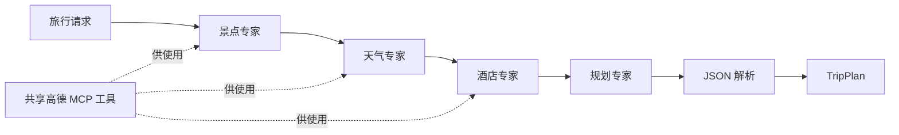

# 第四部分详解：旅行助手、深度研究与赛博小镇

[返回项目总览](../../项目系统讲解.md) · [上一部分](03-高级能力详解.md) · [下一部分](05-毕业设计与社区项目详解.md)

> 对应第十三至十五章。以下按入口、调用链、参数、步骤和状态边界讲解。实现问题来自静态阅读，本次未修复业务代码，也未调用外部模型服务。

## 1. 三个应用分别训练什么能力

| 案例 | 用户目标 | 核心工程问题 |
| --- | --- | --- |
| 旅行助手 | 取得结构化行程 | 多角色分工、工具连接、JSON 输出与页面展示 |
| 深度研究 | 得到有资料支撑的研究报告 | 任务拆分、并发执行、事件流与笔记 |
| 赛博小镇 | 与有个性的角色持续交互 | 人设、记忆检索、关系更新和定时状态 |

它们组合了前文能力，但没有共用一个统一后端。应把每个案例视为独立应用，再比较其中相同的架构问题。

## 2. 第十三章：智能旅行助手

### 2.1 从用户动作追到 HTTP 请求

[Home.vue](../../code/chapter13/helloagents-trip-planner/frontend/src/views/Home.vue) 收集表单，组装 requestData，再调用 [api.ts](../../code/chapter13/helloagents-trip-planner/frontend/src/services/api.ts) 中的 generateTripPlan。

```text
表单提交 → requestData → Axios POST /api/trip/plan
→ FastAPI 解析 TripRequest → 调用规划器
→ 返回 TripPlanResponse → sessionStorage → /result
```

前端将成功返回的 data 序列化存入 sessionStorage 的 tripPlan，随后跳转结果页。这里是浏览器会话存储，不是后端持久化的订单或行程数据库。

### 2.2 页面进度与真实后端进度不是同一数据

Home.vue 使用定时器增加 loadingProgress，并按区间显示“搜索景点”“查询天气”等状态。该页面调用的是一次性 JSON 接口，没有订阅后端阶段事件。

因此这些进度文字是前端等待提示，不能据此判断后端实际执行到了哪个专家 Agent。真实执行阶段需要查看后端日志或另外实现进度事件。

### 2.3 请求模型提供哪些约束

[schemas.py](../../code/chapter13/helloagents-trip-planner/backend/app/models/schemas.py) 定义 TripRequest：

| 字段 | 类型或约束 | 进入后续流程的用途 |
| --- | --- | --- |
| city | 字符串 | 目的地与查询范围 |
| start_date/end_date | 字符串 | 行程时间与输出信息 |
| travel_days | 整数，1～30 | 行程天数 |
| transportation | 字符串 | 交通偏好 |
| accommodation | 字符串 | 酒店查询和行程住宿 |
| preferences | 字符串列表 | 影响景点与规划偏好 |
| free_text_input | 可选字符串 | 自定义补充要求 |

Pydantic 校验数据结构，但当前字段声明没有自动保证“结束日期晚于开始日期且与天数一致”。结构合法与业务一致需要分开验证。

### 2.4 FastAPI 的路由怎样拼接

[trip.py](../../code/chapter13/helloagents-trip-planner/backend/app/api/routes/trip.py) 使用 router 前缀 `/trip`，方法路径 `/plan`；主应用注册 router 时又加 `/api`，最终得到 `/api/trip/plan`。

路径是多个层级组合出来的。排查 404 时，应把应用前缀、router 前缀和方法路径一起看，而不是只搜索某个函数上的装饰器。

### 2.5 四个专家怎样协作

[MultiAgentTripPlanner](../../code/chapter13/helloagents-trip-planner/backend/app/agents/trip_planner_agent.py) 初始化共享 LLM 和 MCPTool，再创建：景点搜索、天气查询、酒店推荐、行程规划四个 SimpleAgent。

前三个添加高德工具，最后一个根据前三者的文字输出综合规划。区别主要来自角色提示词和是否配置工具，而不是四个独立训练过的模型。



实线表达当前执行顺序。前三类查询在业务上可以讨论并行化，但源码目前是串行 `.run()`。

### 2.6 高德工具如何接入

MCPTool 使用 `uvx amap-mcp-server` 启动服务，并把后端的 amap_api_key 映射到子进程环境变量 `AMAP_MAPS_API_KEY`。

这涉及三个不同名字：应用配置字段、读取的环境变量、子进程需要的环境变量。映射正确后，服务才有机会调用地图能力。

初始化完成与查询成功也不同：工具可能已经被发现，但实际调用时因配额、密钥、参数或网络失败。

### 2.7 规划输出怎样变成前端能展示的数据

规划 Agent 输出文本后，`_parse_response()` 依次尝试找 JSON 代码块、一般代码块、花括号包围的 JSON，再用 json.loads 得到字典，最后构造 TripPlan。

```text
模型字符串 → 提取 JSON → Python dict → Pydantic TripPlan
```

TripPlan 包含 city、日期、days、weather_info、overall_suggestions 和可选 budget；DayPlan 下又有 attractions、meals、hotel 等嵌套结构。

输出验证能发现缺字段和部分类型问题，但不能验证某景点真的存在、坐标正确、天气适用于指定日期或预算来自真实价格。

### 2.8 fallback 为什么必须在阅读中显式区分

发生执行或解析错误时，`_create_fallback_plan()` 用输入城市生成“某城市景点1”等占位内容，并使用固定坐标基值生成位置。

它的作用是提供可展示结构，不是可靠旅行方案。路由仍会把返回对象包装为 success=True，前端也可能正常展示。

因此验证本例时应区分三种成功：HTTP 返回成功、数据结构有效、业务资料真实。三者需要不同证据。

### 2.9 对象复用与并发边界

规划器通过模块级变量缓存，模型客户端也通过服务函数缓存。若内部 Agent 保存聊天历史，多次请求可能复用状态，实际行为取决于外部框架。

路由声明 async，但内部直接调用同步规划方法。它没有自动变成并行查询，也没有显式通过线程池隔离这些同步工作。

前端 120 秒超时只表示客户端停止等待。没有完整取消机制时，后端仍可能继续调用模型或工具。

### 2.10 最值得打断点的位置

| 位置 | 检查内容 |
| --- | --- |
| 路由接收后 | 实际请求字段与日期关系 |
| 三个专家调用后 | 是否调用真实工具、返回的是资料还是错误 |
| `_build_planner_query()` | 三路结果是否完整进入规划输入 |
| `_parse_response()` | 原始模型文本与截出的 JSON |
| `_create_fallback_plan()` | 是否在不知情时走了备用结果 |

## 3. 第十四章：自动化深度研究

### 3.1 为什么研究需要显式任务

一个主题可能包含定义、技术路线、优缺点和应用案例。如果直接搜索一次后写报告，容易遗漏某个方面，也难以展示中途进展。

当前实现把主题拆成 TodoItem，每项有自己的 query、摘要、来源和状态，最后再合成报告。任务对象承担了研究过程的可追踪单元。

### 3.2 从前端进入流式后端

[前端 api.ts](../../code/chapter14/helloagents-deepresearch/frontend/src/services/api.ts) 用 fetch 发起 POST `/research/stream`。后端 [main.py](../../code/chapter14/helloagents-deepresearch/backend/src/main.py) 创建 DeepResearchAgent，把 `run_stream()` 事件封装成 SSE：

```text
data: {"type":"task_status", ...}

data: {"type":"task_summary_chunk", ...}

```

空行标识一条事件结束。客户端读取的网络 chunk 未必刚好是一条事件，所以先把文本放入 buffer，再按分隔符解析。

### 3.3 规划服务怎样容忍模型输出差异

[planner.py](../../code/chapter14/helloagents-deepresearch/backend/src/services/planner.py) 调用规划 Agent，尝试从输出中提取 JSON 对象或数组，再取得 tasks。必要时还尝试工具调用文本中的任务数据。

每项被转换成 TodoItem：id 按顺序生成；缺少 title、intent、query 时有默认填充。解析不到任务，编排器会创建单任务兜底。

这种容错可以让流程继续，但默认 query 退回原主题时，研究分解可能变得更粗。验证规划质量应观察任务列表是否覆盖主题，而不只是非空。

### 3.4 单任务执行的实际步骤

[agent.py](../../code/chapter14/helloagents-deepresearch/backend/src/agent.py) 的 `_execute_task()`：

```text
status = in_progress
→ dispatch_search(task.query, config, loop_count)
→ 无结果：status = skipped
→ 有结果：整理 sources_summary 与 context
→ 更新共享研究资料
→ 总结任务内容
→ 保存 task.summary
→ status = completed
```

搜索没有结果和发生执行异常是不同情况：前者可标 skipped，线程 worker 捕获异常后则向前端发送 failed 状态事件。

### 3.5 多线程与队列各承担什么

run_stream 为每项任务创建 Thread。各线程生成事件，写入线程安全 Queue；主生成器从 Queue 取事件，再输出给 HTTP 层。

Queue 把“任务在哪里执行”和“事件怎样按一个通道发送”分开。线程完成顺序不固定，前端依靠 task_id 和 stream_token 把分片归到对应任务。

Lock 用于部分共享状态更新，例如追加资料和增加计数；它不意味着整个 Agent、LLM 客户端和全部工具天然没有并发风险。

### 3.6 事件顺序与业务状态

| 事件 | 作用 |
| --- | --- |
| status | 人可读的阶段提示 |
| todo_list | 初始化任务面板 |
| task_status | 更新某项任务进度 |
| sources | 展示本任务取得的来源 |
| task_summary_chunk | 增量追加摘要文本 |
| final_report | 最终综合报告 |
| report_note | 保存报告的笔记信息 |
| done | 正常结束事件流 |

全局 done 表示编排走到结束，不代表每个任务都有资料。报告生成时仍应考虑 skipped 或 failed 的任务。

worker 失败时当前代码主要发送 failed 事件，没有在该异常分支同步把 TodoItem.status 改为 failed。因此前端看到的事件状态与后续报告读取的内存状态也应分别核对。

### 3.7 总报告如何使用各任务结果

[reporter.py](../../code/chapter14/helloagents-deepresearch/backend/src/services/reporter.py) 把任务标题、目标、query、状态、摘要和来源拼成 prompt，并提供笔记引用，让报告 Agent 整合资料。

返回后清理工具调用标记和按配置清理 thinking token，再得到可展示的文本。报告生成与报告持久化是分开的步骤：编排器随后调用 `_persist_final_report()`，使用 NoteTool 创建或更新结论笔记。

保存笔记失败不等于报告文本没有生成；报告生成成功也不等于笔记已可靠保存。检查最终产物时，要同时看内容与路径/ID。

### 3.8 普通接口的生成器问题

普通 `/research` 调用 run，run 内直接调用 `_execute_task()`；但该方法包含 yield，是生成器函数。调用它只创建生成器对象，不会立刻执行内部搜索。

概念示例：

```python
def work():
    print("执行任务")
    yield "事件"

g = work()       # 创建生成器，尚未打印
list(g)         # 消费生成器，才执行方法体
```

流式路径用 for 迭代它，普通路径没有消费。这是两个接口行为可能不一致的直接原因。本文记录该问题，没有调整实现。

### 3.9 取消、共享目录与恢复边界

前端 AbortSignal 中止读取，后端没有对应的完整取消令牌传到每个线程；run_stream 的 finally 还会 join 工作线程。因此取消页面等待不能被解释为外部搜索和模型调用已经全部停止。

研究状态随请求创建，而 notes_workspace 可跨请求共用。请求对象隔离不自动等于文件路径隔离；多研究同时运行时应检查笔记 ID、文件命名和写入冲突。

## 4. 第十五章：赛博小镇

### 4.1 这是哪种“世界模拟”

当前案例重点是办公室 NPC 的对话、环境对白、记忆和关系变化。Godot 表现角色与交互，Python 后端处理语言模型和状态。

角色看起来在一个场景中生活，不意味着所有移动、日程和行为都由 LLM 自主规划。需要分别追踪 Godot 脚本控制的行为与后端生成的语言内容。

### 4.2 启动生命周期

[main.py](../../code/chapter15/Helloagents-AI-Town/backend/main.py) 的 lifespan 在启动时读取配置、初始化 NPC 管理器、创建状态管理器并开始更新；关闭时停止后台更新任务。

状态管理器 start 会先执行一次更新，再创建后台循环。因此服务启动耗时也可能包含首次对白生成。

### 4.3 人设怎样进入模型

[agents.py](../../code/chapter15/Helloagents-AI-Town/backend/agents.py) 中 NPC_ROLES 保存职业、性格、专长、位置、说话风格等字段。create_system_prompt 将它们格式化为角色约定。

人设是对模型的输入约束，不是强类型行为保证。验证一致性需要跨多个问题观察回复是否符合角色，而不能只看某一次自我介绍。

### 4.4 一次聊天的增强输入

chat 先读取好感度，生成关系和风格说明；再从 working/episodic 检索相关记忆；最后拼入当前用户消息。

```text
【当前关系】与玩家的关系及好感度
【对话风格】关系对应的表达方式
【相关记忆】本次检索得到的历史
【当前对话】玩家现在说的话
```

这种做法将长期状态转化为本次模型可见的文本。关系分数存于字典，只有被转换成提示词后，才有机会影响语言生成。

### 4.5 记忆到底写入哪一种类型

管理器同时启用 working 与 episodic，但 `_save_conversation_to_memory()` 明确把玩家消息和 NPC 回复先写为 working，附带 player_id、session_id、时间、好感度和情绪等 metadata。

不要因为启用了 episodic，就认为每条对话都立即保存成情景记忆。后续整合或持久化行为需要查看实际 MemoryManager 实现。

### 4.6 好感度是一次额外分析

[relationship_manager.py](../../code/chapter15/Helloagents-AI-Town/backend/relationship_manager.py) 用独立 analyzer_agent 分析本轮对话，解析 should_change、change_amount、reason 和 sentiment。

如需变化，则当前值加变化量，并裁剪到 0～100。然后写入 `affinity_scores[npc_name][player_id]`。

这意味着一次玩家聊天可能产生回复生成和关系分析两次模型交互。性能与成本不应只按一次回复估算。

字典在进程内保存；当前实现未展示好感度的独立持久化加载。重启前后的关系状态应单独验证。

### 4.7 多玩家参数存在不等于 API 已支持

内部 chat 接受 player_id，但当前 ChatRequest 只有 npc_name 和 message，路由调用 chat 时没有显式传玩家 ID，因此使用默认 player。

这比“是否传入查询过滤”更前一层：HTTP 请求契约本身就没有承载独立玩家身份。若扩展多玩家，需要贯通请求、状态键、检索和历史隔离，而不能只给一个内部函数加参数。

### 4.8 定时对白为什么使用另一条路径

[state_manager.py](../../code/chapter15/Helloagents-AI-Town/backend/state_manager.py) 定期调用 batch_generator，一次生成多个 NPC 的环境对白，写进 current_dialogues。

Godot [api_client.gd](../../code/chapter15/Helloagents-AI-Town/helloagents-ai-town/scripts/api_client.gd) 通过 HTTPRequest 查询状态，解析 JSON 后发出 npc_status_received 信号，场景脚本更新展示。

信号是客户端组件之间的通知机制；HTTP 请求是客户端与后端的通信机制。两者连接起来形成“请求结果 → 事件 → UI 更新”。

### 4.9 模拟模式与错误包装

LLM 初始化失败或某 NPC 不可用时，管理器可以给出模拟回复；聊天异常也可能被转为普通字符串。路由拿到字符串后仍包装 success=True。

因此测试时既要看 HTTP 状态，也要看返回内容和后端日志。看到气泡文本不能直接证明模型、记忆与关系更新全部工作正常。

## 5. 三个案例的共同架构问题

| 问题 | 旅行助手 | 深度研究 | 赛博小镇 |
| --- | --- | --- | --- |
| 编排单位 | 专家角色 | Todo 任务 | NPC 与后台更新 |
| 结果形式 | TripPlan JSON | 任务事件与 Markdown | 聊天消息与状态 JSON |
| 主要状态 | 共享规划器对象 | 请求内研究状态与笔记 | NPC 对象、记忆、好感度、缓存 |
| 进度呈现 | 前端定时等待提示 | 后端真实事件流 | 周期拉取状态 |
| 失败容错 | 备用行程 | 跳过、失败事件、兜底任务 | 模拟回复与错误文字 |
| 最需核对 | 结构成功与资料真实 | 生成器消费、状态一致、取消 | 玩家隔离与持久化 |

## 6. 学习练习：选一个请求完整追踪

建议首先跟踪旅行请求，因为调用链相对线性。记录页面输入、请求 JSON、路由参数、每个 Agent 的输入输出、最终 JSON 与结果页数据。

再跟踪研究任务的事件生命周期，最后观察小镇连续聊天的记忆与好感度变化。每次只追一个请求或角色，能避免被大量日志淹没。
