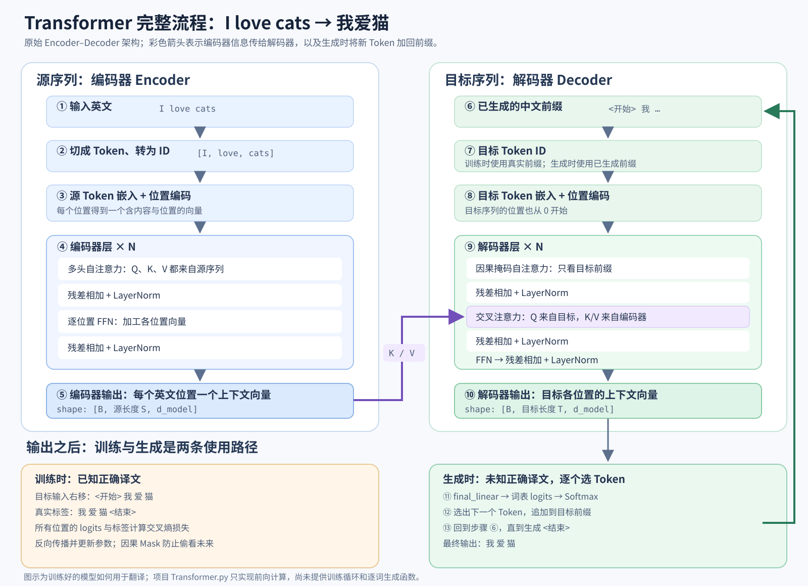
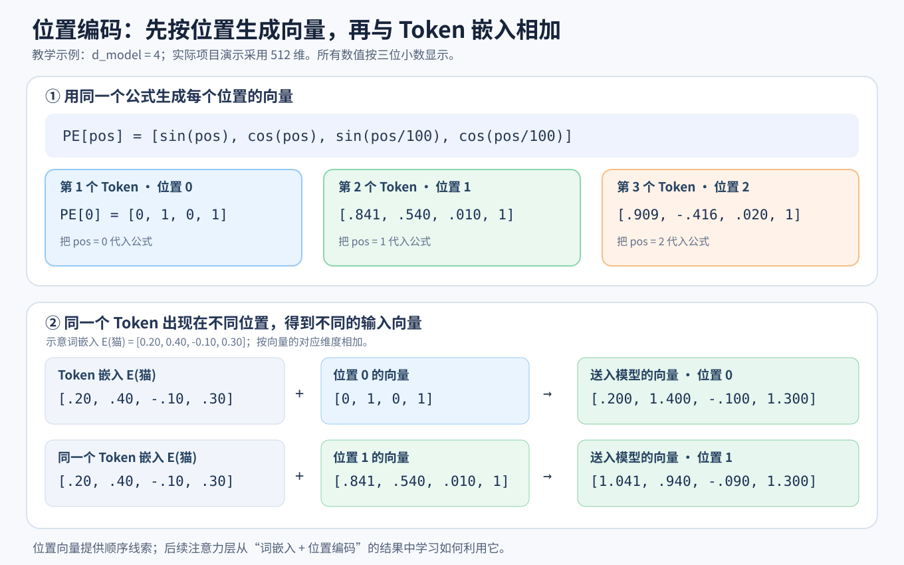

# Transformer 架构原理详解

[返回第一部分学习指南](01-智能体与语言模型基础详解.md) · [用翻译例子走完整流程](07-Transformer完整流程示例.md) · [阅读第三章原文](../chapter3/第三章%20大语言模型基础.md)

> 本文以第三章 3.1.2—3.1.3 节为基础，梳理 Transformer 的动机、组成模块、编码器与解码器、训练与生成，以及 Decoder-Only 大语言模型。若想先看具体句子如何通过各模块，建议阅读上面的翻译例子。文中的词、Token、权重和概率示例均为教学示意。

## 1. Transformer 要解决什么问题

语言模型的基本任务之一是根据已有上下文，给下一个 Token 在词汇表上的候选项分配概率：

```text
输入：今天天气很
输出：P(好 | 今天天气很)、P(热 | 今天天气很)、……
```

关键问题是**如何把上下文加工成可用于预测的表示**。早期 N-gram 模型只使用有限长度的前文；RNN、LSTM 用隐藏状态逐步处理序列。RNN 在处理第 `t` 个位置时需要前一个位置的计算结果，因此序列内部有串行依赖。Transformer 改用注意力机制，让各位置直接从可见的其他位置汇总信息；训练时可以用矩阵运算处理多个位置。

这并不等于生成时可以同时知道所有未来 Token：自回归模型仍通常逐个生成下一个 Token。

## 2. 原始架构总览：Encoder–Decoder

最初的 Transformer 用于机器翻译等序列到序列任务，包含编码器和解码器：



*图：从源序列和目标前缀进入模型，到训练时比较标签、生成时逐词循环的完整路径。*

```text
源序列 Token ─→ 编码器 ─→ 源序列各位置的上下文表示
                                  │
目标序列已有前缀 ─→ 解码器 ◀────────┘
                       │
                       └─→ 下一个目标 Token 的概率分布
```

以 `I love cats → 我爱猫` 为例：编码器处理完整英文句子；解码器看已生成的中文，并参考编码器输出，决定下一个中文 Token。编码器的“理解”和解码器的“生成”是功能描述，具体工作都由向量计算完成。

编码器由多层相似结构堆叠，解码器也由多层相似结构堆叠。后面所说的一个“层”，通常只是整个模型的其中一层。

在项目的 [`Transformer.py`](../../code/chapter3/Transformer.py) 中，对应的类与调用顺序是：

```text
Transformer.forward(src, tgt)
├─ generate_mask(src, tgt)  → src_mask、tgt_mask
├─ Encoder.forward(src, src_mask)
│  ├─ embedding → pos_encoder
│  └─ 多个 EncoderLayer → 最终 LayerNorm
├─ Decoder.forward(tgt, encoder_output, src_mask, tgt_mask)
│  ├─ embedding → pos_encoder
│  └─ 多个 DecoderLayer → 最终 LayerNorm
└─ final_linear(decoder_output) → 目标词表 logits
```

这里 `src`、`tgt` 是整数 Token ID 张量，不是原始文字；`forward` 的返回值是分数张量，还不是翻译好的句子。源码末尾用随机 ID 演示一次前向传播，没有加载训练好的权重，也没有分词、训练、损失计算或自动生成循环。下文的翻译内容用于解释模型**经过训练后如何工作**。

## 3. 输入准备：Token、嵌入与位置

### 3.1 Token 化和嵌入

文本首先被分词器切成 Token，再转换为 ID；嵌入层把 ID 映射为连续向量：

```text
文本 → Token → Token ID → 嵌入向量
```

例如：

```text
今天 → [0.2, 0.7, -0.1, ...]
天气 → [0.8, 0.3,  0.4, ...]
很   → [0.1, 0.5,  0.6, ...]
```

向量数值由训练得到。示例为了易读把 Token 写成词；实际一个词可能对应多个 Token。如果批大小为 `B`，序列长度为 `L`，隐藏维度为 `D`，嵌入后的张量形状通常可写为 `[B, L, D]`。

### 3.2 为什么需要位置信息

普通自注意力会比较各位置的内容，但单靠这一步，不知道一个 Token 原来排在第几位。考虑两句话：

```text
我 喜欢 你
你 喜欢 我
```

在没有位置编码、因果 Mask 或其他顺序信号的自注意力中，如果只提供 Token 嵌入，模型知道有“我”“喜欢”“你”，却没有显式的位置线索来区分两种顺序。原始 Transformer 因此为每个位置准备一个与 Token 嵌入**维度相同**的位置向量，再逐元素相加：

```text
第 pos 个位置的输入向量 = 该位置的 Token 嵌入向量 + 位置 pos 的编码向量
```

这里的“加入”是数字相加：不是在文本末尾写上“位置 2”，也不是在向量后面拼接几个数字。比如两个四维向量：

```text
Token 嵌入：    [0.20, 0.40, -0.10, 0.30]
位置编码：      [0.00, 1.00,  0.00, 1.00]
逐元素相加后：  [0.20, 1.40, -0.10, 1.30]
```

相加后向量仍是四维，所以能直接进入后面的注意力层。同一个 Token 出现在不同位置时，Token 嵌入相同，加入的位置编码不同，最终输入向量就不同；不同 Token 出现在同一位置时，使用相同的位置编码，但 Token 嵌入不同。

### 3.3 位置向量从哪里来：正弦和余弦

第三章和项目的 [`PositionalEncoding`](../../code/chapter3/Transformer.py) 使用原始 Transformer 的**固定正弦、余弦编码**。设位置从 `pos = 0` 开始，隐藏维度为 `D = d_model`，第 `i` 对维度采用：

```text
PE[pos, 2i]   = sin(pos / 10000^(2i/D))
PE[pos, 2i+1] = cos(pos / 10000^(2i/D))
```

这里 `pos` 是 Token 在序列中的下标：第一个 Token 是位置 0，第二个是位置 1。`i` 是**维度对的编号**，不是 Token 的编号；`i = 0` 对应向量第 0、1 维，`i = 1` 对应第 2、3 维。偶数维度用正弦，紧邻的奇数维度用余弦。三角函数的输入按弧度计算。

把维度缩小到 `D = 4`，公式就能逐项展开：

| 维度对 `i` | 对应的向量维度 | 分母 `10000^(2i/4)` | 这一对维度的值 |
| --- | --- | ---: | --- |
| `0` | 第 0、1 维 | `1` | `sin(pos)`、`cos(pos)` |
| `1` | 第 2、3 维 | `100` | `sin(pos/100)`、`cos(pos/100)` |

因此，**整个四维位置向量的定义**就是：

```text
PE[pos] = [sin(pos), cos(pos), sin(pos/100), cos(pos/100)]
```

现在只需把具体位置代进去：

```text
位置 0：PE[0] = [sin(0), cos(0), sin(0), cos(0)]
             = [0, 1, 0, 1]

位置 1：PE[1] = [sin(1), cos(1), sin(0.01), cos(0.01)]
             ≈ [0.841, 0.540, 0.010, 1.000]

位置 2：PE[2] = [sin(2), cos(2), sin(0.02), cos(0.02)]
             ≈ [0.909, -0.416, 0.020, 1.000]
```

位置编号 1 和 2 的向量不是单独手写的规则，而是把 `pos = 1` 或 `pos = 2` 代入**同一个公式**得到的。位置 1 的最后一维实际约为 `0.99995`，这里四舍五入到三位小数。不同维度变化的快慢不同：前两维随位置变化较快，后两维较慢。项目示例使用 `d_model = 512`，会以同样方式生成每个位置的 512 维向量。

假设同一个 Token 的嵌入向量始终是 `[0.20, 0.40, -0.10, 0.30]`，那么它出现在不同位置时：

```text
出现在位置 0：
[0.20, 0.40, -0.10, 0.30] + [0.000, 1.000, 0.000, 1.000]
= [0.200, 1.400, -0.100, 1.300]

出现在位置 1：
[0.20, 0.40, -0.10, 0.30] + [0.841, 0.540, 0.010, 1.000]
≈ [1.041, 0.940, -0.090, 1.300]
```

这组数只是用来展示相加过程。位置编码不是“第 1 维只存位置、第 2 维只存词义”的硬分区；两种信息混在同一个向量中，后续 Q、K、V 投影和注意力层从这个输入中学习利用它们。



*图：四维教学示例中，位置 0、1、2 由同一公式生成；同一个 Token 的嵌入与不同位置向量相加后，送入模型的结果不同。*

### 3.4 对照项目代码：预先生成、切片、广播、相加

项目中的实现可以压缩成下面几行；完整代码见 [`Transformer.py` 的 `PositionalEncoding` 类](../../code/chapter3/Transformer.py)：

```python
position = torch.arange(max_len).unsqueeze(1)
div_term = torch.exp(torch.arange(0, d_model, 2) * (-math.log(10000.0) / d_model))
pe = torch.zeros(max_len, d_model)
pe[:, 0::2] = torch.sin(position * div_term)
pe[:, 1::2] = torch.cos(position * div_term)
self.register_buffer("pe", pe.unsqueeze(0))

# forward 中：
x = x + self.pe[:, :x.size(1)]
return self.dropout(x)
```

对应刚才的四维例子：`torch.arange(0, 4, 2)` 得到 `[0, 2]`；`div_term` 算出的两个乘数是 `[1, 0.01]`。当 `position` 取 1 时，`position * div_term` 得到 `[1, 0.01]`；分别取正弦、余弦并交错放入 `pe`，就得到 `[sin(1), cos(1), sin(0.01), cos(0.01)]`。这说明代码确实在批量计算上面的公式，而非另行定义了一套位置编号。

按数据形状读代码最容易理解。这里假定 `d_model` 为偶数，项目示例值为 512：

| 变量或操作 | 形状 | 作用 |
| --- | --- | --- |
| `position` | `[max_len, 1]` | 列出位置 `0, 1, …, max_len−1` |
| `div_term` | `[d_model/2]` | 为每对维度准备不同的变化尺度 |
| `position * div_term` | `[max_len, d_model/2]` | 利用广播，组合每个位置和每个尺度 |
| `pe` | `[max_len, d_model]` | 将正弦值放入偶数维，余弦值放入奇数维 |
| `pe.unsqueeze(0)` | `[1, max_len, d_model]` | 增加批次维度 |
| `self.pe[:, :x.size(1)]` | `[1, L, d_model]` | 只取当前序列长度 `L` 所需的位置 |
| `x + ...` | `[B, L, d_model]` | 对批次中每条序列逐位置、逐维度相加 |

例如 `B = 2`、`L = 3`、`d_model = 4`，`x` 的形状是 `[2, 3, 4]`，取出的位置编码形状是 `[1, 3, 4]`。PyTorch 将这三条位置向量**广播**给两个样本，然后分别与各 Token 嵌入相加；同一位置使用相同位置编码，两个样本的 Token 嵌入仍可不同。

`register_buffer` 表示位置矩阵随模型保存、随模型移动到 CPU/GPU，但不是通过梯度训练的参数。`dropout` 只在训练模式下随机屏蔽部分相加后的元素，属于常规正则化，不负责“计算位置”。项目在**编码器与解码器各自的嵌入层之后**调用 `pos_encoder`；两边都有自己的序列位置，均从 0 开始计数。

这份实现预先创建最多 `max_len` 个位置的编码。传入的序列长度 `L` 应不超过 `max_len`；超过时，切片拿不到足够的位置，后续相加会因长度不匹配而失败。现代模型可能采用可学习位置嵌入、旋转位置编码等不同实现，不能把这个“逐元素相加正弦编码”的实现套到所有 Transformer 上。

更严谨地说，缺少任何顺序信号的普通自注意力在调换输入位置时会相应调换输出位置，无法单凭这一步可靠地区分原始顺序。位置信息使后续层有条件利用顺序，但不意味着我们能仅凭某一维数字直接读出“它是第几个词”。

### 3.5 模型怎样从位置向量中利用先后关系

位置编号 `p=0,1,2,...` 是程序按序列顺序指定的整数；正弦编码再把整数映射为向量。它不是根据词义计算位置，也不是比较向量的大小就能排序。例如第一维 `sin(1) < sin(2)`，但继续增加位置后正弦值会下降，因此“数值更大就是更靠后”不成立。

对某一对维度，设频率为 `ω`，该位置的两个数是 `[sin(ωp), cos(ωp)]`。两个位置 `p、q` 有如下关系：

```text
sin(ωp)cos(ωq) − cos(ωp)sin(ωq) = sin(ω(p−q))
sin(ωp)sin(ωq) + cos(ωp)cos(ωq) = cos(ω(p−q))
```

第一式包含有方向的相对位移，交换 `p、q` 会变号；第二式是对称的，交换前后不变。由于周期性，不能仅凭某一个频率的正负在任意远距离上判断先后，需要多组频率共同提供信号，并由网络训练学习使用。

进一步看，固定偏移 `Δ` 对应每对维度的旋转：

```text
sin(ω(p+Δ)) = cos(ωΔ)sin(ωp) + sin(ωΔ)cos(ωp)
cos(ω(p+Δ)) = −sin(ωΔ)sin(ωp) + cos(ωΔ)cos(ωp)
```

这解释了原论文为何强调相对偏移具有可学习的结构。但模型并不一定先“解码出位置整数”再比较。加入位置的表示经过 `W_Q、W_K` 投影，训练会让注意力利用对任务有用的词义与位置信号。**直接对两个原始正弦位置向量做点积是对称的，不能单独区分方向；学习到的不同投影及其他上下文使关系可以不对称。** [原始论文的位置编码说明](https://arxiv.org/html/1706.03762v7)

还要把位置编码与因果 Mask 分开：位置编码提供位置信息，因果 Mask 用程序规则禁止读取未来。即使没有显式位置编码，因果 Mask 本身也带来方向约束。因此“没有位置编码就完全不含顺序信息”的说法，只能在没有其他位置信号、没有因果约束等条件下讨论，不能套到所有模型。

### 3.6 论文与本地教学实现并非逐项相同

原论文使用 `sqrt(d_model) × TokenEmbedding + PositionEncoding`；本地 `Transformer.py` 直接将嵌入与位置编码相加，没有这一嵌入缩放。原论文还讨论权重共享，而本地嵌入层与输出线性层是分别定义的。阅读教学代码时应区分“展示核心机制”与“完全复刻原论文”。学习型绝对位置编码则把位置向量本身作为可训练参数，不使用上述固定正弦公式。

## 4. 自注意力：让一个位置利用上下文

看句子：

```text
小明把书放在桌子上，因为他要去吃饭。
```

处理“他”时，模型需要利用上下文。自注意力会为各个可见位置计算权重，并把这些位置的信息加权汇总成“他”的新表示。示意权重可能是：

| 被参考的位置 | 示意权重 |
| --- | ---: |
| 小明 | 0.60 |
| 书 | 0.05 |
| 桌子 | 0.05 |
| 因为 | 0.10 |
| 他 | 0.20 |

权重只是示例，也不能直接当作模型决策的完整解释。“自”表示查询位置和被参考位置来自同一个序列，并非只能关注自己。

### 4.1 Q、K、V 的分工

对输入矩阵 `X` 做三次可学习的线性投影：

```text
Q = XW_Q   Query：当前位置用什么特征去匹配
K = XW_K   Key：每个位置提供什么特征供匹配
V = XW_V   Value：每个位置提供什么内容供汇总
```

处理“他”时，用“他”的 Q 与各位置的 K 计算匹配分数，将分数转换成权重，再按照权重汇总各位置的 V。同一个头中的投影参数由各位置共享；每个位置得到的 Q、K、V 向量仍会因输入不同而不同。

### 4.2 计算分数与加权汇总

缩放点积注意力的公式是：

```text
Attention(Q, K, V) = softmax(QKᵀ / √d_k)V
```

按顺序理解：

1. `QKᵀ`：计算每个查询位置与各键位置的匹配分数。
2. `/ √d_k`：控制分数的数值尺度；`d_k` 是键向量维度。
3. `softmax`：将一个查询位置对应的分数转为非负、总和为 1 的权重。
4. 乘 `V`：按权重汇总各位置的信息。

这里的 Softmax 得到**注意力权重**。模型最终还会经过输出层和另一次 Softmax，才得到**下一个 Token 在词汇表上的概率**；两个概率分布回答的是不同问题。

### 4.3 手算一个位置：分数怎样变成新向量

为看清计算，把 `I love cats` 中的 `love` 设为当前查询位置。假设某个注意力头的向量维度 `d_k = 2`，投影后得到以下**虚构的** Q、K、V：

```text
Q(love) = [1, 0]

位置       K          V
I       [1, 0]     [1, 0]
love    [0, 1]     [0, 1]
cats    [1, 1]     [1, 1]
```

第一步，用 `Q(love)` 与各位置的 K 点积，再除以 `√2`：

```text
I:     ([1, 0] · [1, 0]) / √2 ≈ 0.707
love:  ([1, 0] · [0, 1]) / √2 = 0
cats:  ([1, 0] · [1, 1]) / √2 ≈ 0.707
```

第二步，对 `[0.707, 0, 0.707]` 做 Softmax，得到约 `[0.401, 0.198, 0.401]`。这三个权重加起来约为 1。第三步，按权重汇总各位置的 V：

```text
0.401 × [1, 0] + 0.198 × [0, 1] + 0.401 × [1, 1]
≈ [0.802, 0.599]
```

`[0.802, 0.599]` 是这个头为 `love` 位置算出的上下文结果，还要与其他头的结果合并、经过输出投影及后续子层。这里的 K、V 是人为设定以方便手算；实际值由输入向量和训练得到的投影参数共同决定。`I` 和 `cats` 也各自有 Q，会分别得到自己的结果。

## 5. 多头注意力：从多组表示中汇总信息

如果只做一组 Q、K、V 计算，就只有一个注意力头。多头注意力让不同的头使用不同的投影参数，分别计算，再合并输出：

```text
输入 X ─┬─→ 头 1 ─┐
        ├─→ 头 2 ─┼─→ 拼接 → 输出投影
        └─→ 头 3 ─┘
```

多个头允许模型从不同表示空间汇总信息。教学时可以设想某个头关注指代、另一个头关注局部关系，但不能认为训练后每个头都固定对应一种人类可命名的语法功能。

若有 `H` 个头，每头宽度为 `d`，且 `D = H × d`，常见形状变化为：

| 步骤 | 张量形状 |
| --- | --- |
| 输入 | `[B, L, D]` |
| 拆成 H 个头 | `[B, H, L, d]` |
| 注意力分数 | `[B, H, L, L]` |
| 各头汇总后的结果 | `[B, H, L, d]` |
| 合并各头 | `[B, L, D]` |

这也解释了为什么注意力适合用矩阵运算处理多个位置。自注意力的分数矩阵与序列长度有关，通常是每个头一个 `L × L` 矩阵，因此长序列也会带来计算和内存成本。

在项目演示配置中，`d_model = 512`、`num_heads = 8`，所以每头维度 `d_k = 512 / 8 = 64`。源码先用 `W_q/W_k/W_v` **分别**投影完整的 512 维输入，再将每个投影结果拆为 8 个 64 维头；各头算完后拼接回 512 维，再经过 `W_o`。因此“多头”不表示把原始词向量任意切开后重复同一计算，而是投影参数和不同子空间共同决定每个头看到什么。

## 6. Mask：控制哪些位置能参与注意力

Mask 会在 Softmax 之前屏蔽不允许读取的位置，使其注意力权重变为零或接近零。常见的两种用途是：

| Mask | 解决的问题 |
| --- | --- |
| Padding Mask | 批量输入为了对齐长度补了空白位置；这些位置不应作为真实内容被读取 |
| Causal Mask（因果掩码） | 自回归预测时，当前位置不能看到后面的目标 Token |

以 `我 喜欢 北京 烤鸭` 为例，因果掩码控制可见范围：

| 当前 Token | 可以关注 |
| --- | --- |
| 我 | 我 |
| 喜欢 | 我、喜欢 |
| 北京 | 我、喜欢、北京 |
| 烤鸭 | 我、喜欢、北京、烤鸭 |

当前 Token 通常可以关注自己和之前的位置，不能关注未来位置。训练时即使完整句子已经放入输入，掩码仍能阻止当前位置通过注意力偷看后面的答案。生成时未来 Token 本来就尚未生成。

编码器处理完整源句时一般不使用这种因果掩码，但仍可能用 Padding Mask 忽略补齐位置。

对四个目标 Token，因果掩码可以画成下三角矩阵。行表示正在处理的位置，列表示它能否读取那个位置；`1` 是可读，`0` 是屏蔽：

```text
              列：<开始>  我  爱  猫
行：<开始>           1    0   0   0
    我              1    1   0   0
    爱              1    1   1   0
    猫              1    1   1   1
```

项目的 `generate_mask` 把目标的 Padding Mask 与这个下三角 Mask 做逻辑与：

```python
src_mask = (src != 0).unsqueeze(1).unsqueeze(2)
tgt_pad_mask = (tgt != 0).unsqueeze(1).unsqueeze(2)
tgt_sub_mask = torch.tril(torch.ones((tgt_len, tgt_len), device=src.device)).bool()
tgt_mask = tgt_pad_mask & tgt_sub_mask
```

这里约定 ID `0` 为填充位；`src_mask` 使编码器自注意力和解码器交叉注意力忽略源序列的填充位，`tgt_mask` 使解码器自注意力同时忽略目标填充位与未来位置。源码在注意力分数上用 `masked_fill(mask == 0, -1e9)`，之后才做 Softmax；`-1e9` 在这里用于使对应权重近似 0。这个教学实现没有单独处理“某查询行所有键都被屏蔽”的特殊情况，也不把目标填充行从网络输出中删除；实际训练还需在损失计算中忽略填充目标。

## 7. FFN、残差连接和层归一化

多头注意力之后，每个位置还会经过**逐位置前馈网络（FFN）**。第三章给出的简化形式是：

```text
FFN(x) = ReLU(xW₁ + b₁)W₂ + b₂
```

它分别加工各位置向量，所有位置共享同一组 FFN 参数。注意力负责让位置之间交换信息；FFN 对每个位置汇总后的表示再做非线性变换。现代模型可能使用其他激活函数或 FFN 结构。

项目演示配置为 `d_model = 512`、`d_ff = 2048`，因此对一个位置来说，FFN 的形状变化是：

```text
512 维输入 → 第一线性层 → 2048 维 → ReLU → 第二线性层 → 512 维输出
```

序列长度并不因 FFN 改变；例如输入 `[B, L, 512]`，输出仍为 `[B, L, 512]`。项目在 ReLU 和第二线性层之间还有 Dropout，训练时用于正则化。

各子层外还常有：

- **残差连接**：将输入 `x` 加回子层输出，即 `x + Sublayer(x)`，帮助信息与梯度在深层网络中传播。
- **层归一化**：控制向量的数值尺度，有助于训练稳定。

原始 Transformer 的一种顺序是 `LayerNorm(x + Sublayer(x))`。后续模型也可能先归一化，再进行子层计算。残差有助于缓解深层训练问题，但不是任何情况下“彻底消除梯度消失”的保证。

源码中的一个具体步骤是：

```python
attn_output = self.self_attn(x, x, x, mask)
x = self.norm1(x + self.dropout(attn_output))
```

`attn_output` 与 `x` 形状相同，才能逐元素相加。`LayerNorm(d_model)` 对每个位置向量的最后一维做归一化；不会把整批样本或整段句子的所有数字一起算一个均值。

### 7.1 LayerNorm 究竟沿哪个维度计算

对于形状 `[B,T,D]` 的表示，`LayerNorm(D)` 通常对每个样本、每个位置各自的 D 个特征计算均值和方差：

```text
μ = mean(x 的 D 个特征)
σ² = mean((x − μ)²)
y = γ × (x − μ) / sqrt(σ² + ε) + β
```

`γ、β` 是可训练的缩放与偏移，`ε` 避免分母为零。它不把一个 batch 的所有句子混起来归一化，也不负责混合不同位置的信息。Post-Norm 是 `LN(x + Sublayer(x))`，Pre-Norm 是 `x + Sublayer(LN(x))`；本地层采用前一种顺序，不能据此认为所有现代大模型都相同。

注意力中的 `sqrt(d_k)` 则是另一个缩放：在 Q/K 分量独立、零均值且方差为 1 的简化假设下，点积的方差约为 `d_k`，除以 `sqrt(d_k)` 使尺度更稳定，减轻 Softmax 过度饱和。这与 LayerNorm 的计算不是一回事。

## 8. 编码器层与解码器层怎么组合

### 8.1 编码器层

```text
输入
 ↓
多头自注意力：汇总源序列各位置的信息
 ↓
残差 + 归一化
 ↓
FFN：加工各位置向量
 ↓
残差 + 归一化
 ↓
输出
```

堆叠多层后，编码器为源序列每个位置都输出一个带上下文的向量。这些输出会交给解码器。

### 8.2 原始 Transformer 的解码器层

```text
目标序列已生成的前缀
 ↓
掩码多头自注意力：查看已有目标 Token
 ↓
交叉注意力：查看编码器输出
 ↓
FFN：加工当前位置的表示
 ↓
输出
```

三个子层周围同样有残差和归一化。

**自注意力**在目标序列内部计算，Q、K、V 来自同一个序列；**交叉注意力**由解码器提供 Q，编码器输出提供 K、V。后者让生成目标语言时能参考输入源语言。

对照源码，交叉注意力调用是：

```python
self.cross_attn(x, encoder_output, encoder_output, src_mask)
```

若目标序列长度为 `T`、源序列长度为 `S`，交叉注意力分数的形状为 `[B, H, T, S]`：**每个目标位置对每个源位置**有一个分数。与自注意力的 `[B, H, T, T]` 相比，最后一维变成源序列长度。对初学者来说，“Q 来自哪里、K/V 来自哪里”是区分自注意力和交叉注意力最可靠的方法。

## 9. 如何得到下一个 Token 的概率

经过多层解码器后，当前位置得到一个上下文向量 `h`。输出层将它映射到词汇表长度的一组分数（logits），再经过 Softmax：

```text
h → 输出投影 → 各候选 Token 的 logits → Softmax → 概率分布
```

例如给定上下文 `今天天气很`，示意结果可以是：

| 候选 Token | 示意概率 |
| --- | ---: |
| 好 | 0.50 |
| 热 | 0.25 |
| 冷 | 0.15 |
| 差 | 0.06 |
| 其他 | 0.04 |

系统选出一个 Token，例如“好”，接到已有内容后，再计算下一轮。选取方式可以是取最大概率，也可以按采样策略选择。

项目源码的 `final_linear` 只做 `d_model → tgt_vocab_size` 的线性映射，直接返回 logits，**没有在 `forward` 中做 Softmax**。推理时若需要概率，可以对最后一个目标位置的 logits 做 Softmax；训练时通常直接把 logits 交给交叉熵损失函数，由损失函数在内部完成相应计算。

## 10. 训练与生成为什么看起来不同

训练时有完整的正确文本，可以让模型在一次计算中预测多个位置，并把每个位置的预测与真实下一个 Token 比较：

```text
输入：<开始> 我 爱 猫
目标：我     爱 猫 <结束>
```

因果掩码保证某位置无法利用它后面的目标 Token。程序根据预测误差反向传播，更新嵌入、注意力、FFN、输出层等参数。

训练样本通常将正确目标序列错位：输入给解码器的是“起始符 + 已知前缀”，标签是每个位置真正的下一 Token。这种在训练时给出真实前缀的做法常称为 *teacher forcing*。例如模型在“`<开始> 我`”处若误预测“猫”，训练计算下一位置时依然提供真实的“爱”作为前缀；实际生成则只能接着自己选出的 Token 往下走。这个差别解释了训练可以一次计算多位置，而生成必须处理先前生成结果。

当前 [`Transformer.py`](../../code/chapter3/Transformer.py) 只实现模型前向传播和随机输入演示；训练数据构造、损失、优化器、反向传播、解码策略及停止条件都需要另行编写，不能把示例打印的 `[2, 12, 5000]` 当成已完成翻译。

生成时，后续 Token 尚不存在，所以一般按以下顺序进行：

```text
已有文本 → 预测下一个 Token → 选出 Token
         → 追加到已有文本 → 再预测
```

训练时多个已知位置可并行计算，生成时逐步扩展序列，这两句话不矛盾。

## 11. 从原始 Transformer 到 Decoder-Only

本节展开了架构差异；如果要沿着一条文本完整追踪因果掩码、训练标签与逐 Token 生成，可继续阅读[Decoder-Only 架构详解](09-Decoder-Only架构详解.md)。

GPT 类大语言模型通常采用 **Decoder-Only**：提示词和生成内容处于同一条序列，经过多层因果 Transformer，反复预测下一个 Token。它没有独立编码器，因此基础结构中也没有“对编码器输出做交叉注意力”这个子层。

| | 原始 Encoder–Decoder | 基础 Decoder-Only |
| --- | --- | --- |
| 源序列和目标序列 | 分别进入编码器、解码器 | 提示词与生成内容处于同一序列 |
| 编码器 | 有 | 无独立编码器 |
| 因果自注意力 | 解码器中使用 | 核心机制 |
| 对编码器的交叉注意力 | 有 | 无 |

Decoder-Only 仍能利用提示词回答问题；“Only”描述的是网络结构，并不是说它不处理输入。它也不等于原始 Transformer 解码器的每一个实现细节都被原样保留。

## 12. Transformer 与 Agent 的分工

在第一章的旅游助手中，模型可能生成：

```text
Thought: 先查询北京天气。
Action: get_weather(city="北京")
```

这段文本由语言模型逐 Token 生成，而 Transformer 是模型处理上下文的一类核心结构。随后由 Agent 的 Python 程序解析 `Action`、调用 `get_weather`，再把工具结果放进下一轮上下文。**模型生成工具请求；程序负责执行工具。**

## 13. 一张路线图串起来

```text
文本
 ↓
Token 化 → Token ID → 嵌入向量 + 位置信息
 ↓
多层 Transformer：
    注意力：从可见位置汇总信息
    FFN：加工各位置表示
    残差与归一化：帮助深层训练
 ↓
当前位置的上下文向量
 ↓
输出投影 → 词汇表 logits → Softmax
 ↓
下一个 Token 的概率分布
 ↓
选出一个 Token，加入上下文，继续生成
```

如果要把这条抽象路线放到具体句子里，可接着阅读[用翻译例子走完 Transformer 的完整流程](07-Transformer完整流程示例.md)，然后沿着[教学代码](../../code/chapter3/Transformer.py)查看每一步的实际张量操作。
