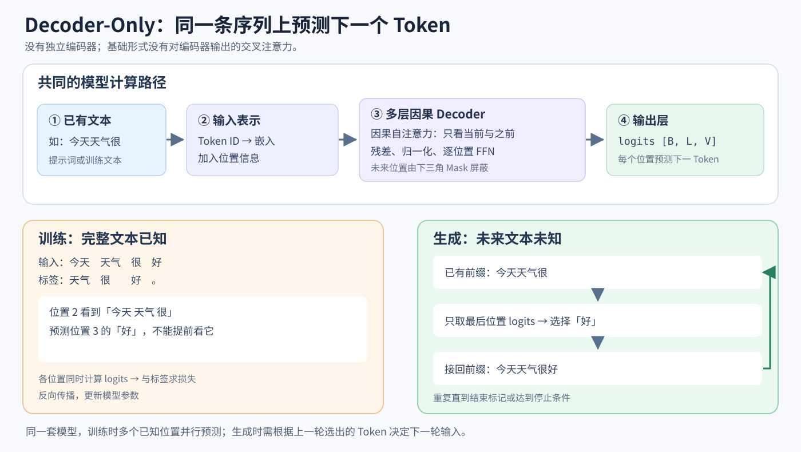

# Decoder-Only 架构详解：从因果注意力到逐 Token 生成

[返回第一部分学习指南](01-智能体与语言模型基础详解.md) · [先读 Transformer 架构](08-Transformer架构原理详解.md) · [对照原始 Encoder–Decoder 翻译例子](07-Transformer完整流程示例.md)

> 对应[Hello-Agents 第三章 3.1.3 节](https://hello-agents.datawhale.cc/#/./chapter3/第三章%20大语言模型基础?id=_313-decoder-only-架构)和[本地第三章](../chapter3/第三章%20大语言模型基础.md)。本文将该节的三个核心观点——只使用因果解码结构、训练时预测下一 Token、生成时逐步续写——展开为一条完整数据流。文中的切词和概率都是教学示意，不是运行模型得到的结果。



*图：模型结构相同；训练时使用完整文本和错位标签，生成时根据最后位置的输出逐步扩展前缀。*

## 1. 先弄清楚“Only”省掉了什么

原始 Transformer 主要用于把一段源序列转换为另一段目标序列，例如将英文翻译成中文：

```text
英文源序列 → Encoder → 源序列的上下文表示
                                  ↓
已生成的中文前缀 → Decoder：掩码自注意力 → 交叉注意力 → FFN → 下一个中文 Token
```

在这种结构中，**交叉注意力**让解码器读取编码器的输出。Decoder-Only 没有单独的编码器；输入提示和后续生成的内容放在**同一条 Token 序列**里，所以基础形式中也不需要“读取编码器输出”的交叉注意力层：

```text
提示词 + 已生成内容
         ↓
Token 嵌入 + 位置信息
         ↓
多层因果自注意力 + FFN
         ↓
下一个 Token 的词表分数
```

“Only”描述的是网络的主要结构，不意味着模型无法理解用户输入。模型处理提示词时，最后一个提示位置可以利用它之前的整个可见提示，再预测回答的第一个 Token。现代模型会调整原始解码器的具体实现，例如归一化顺序、位置表示和 FFN 形式，因此不应把第三章的原始 Decoder 类原封不动地当成某个现代模型的完整源码。

## 2. 它仍然是 Transformer：一层里发生什么

下面用 `x` 表示当前层收到的一串向量。一个基础 Decoder-Only 层可以先理解为：

```text
x
 ↓
因果多头自注意力：每个位置从自己及之前的位置取信息
 ↓
残差连接 + 归一化
 ↓
逐位置前馈网络：对每个位置的表示进一步加工
 ↓
残差连接 + 归一化
 ↓
下一层
```

注意力中，每个位置的向量经过可学习的投影得到 Q、K、V。当前位置的 Q 与**可见位置**的 K 算匹配分数，经 Softmax 变为权重，再按权重汇总 V。多头注意力并行做多组这样的计算，合并后送入 FFN。层与层堆叠后，最后一个位置的向量已经包含之前上下文的信息。

因果自注意力是 Decoder-Only 的关键限制：每个位置可以读取自己及之前的 Token，不能读取之后的 Token。**位置信息**与**因果掩码**分工不同：前者帮助模型利用顺序和距离，后者直接限制哪些位置可见。位置编码如何生成，可看[位置编码详解](08-Transformer架构原理详解.md#32-为什么需要位置信息)。

## 3. 用一句话分清“看到什么”和“预测什么”

假设训练文本被切成以下 Token；真实分词器可能采用完全不同的切法：

```text
位置：   0      1     2    3
Token： 今天   天气    很   好
```

在**位置 2**，当前 Token 是“很”。该位置的向量允许汇总位置 0、1、2，也就是“今天 天气 很”；它会用于**预测位置 3 的下一个 Token“好”**：

```text
计算位置 2 的表示：看到“今天 天气 很”
位置 2 的输出目标：预测下一个 Token“好”
```

这是两个容易混在一起的问题：**注意力能看哪些输入位置**，以及**这个位置要预测哪个标签**。当前 Token 可以看自己，但当前输出的训练标签是它后面的 Token，所以没有偷看答案。

用概率记号表达，就是模型估计：

```text
P(“好” | “今天 天气 很”)
```

它先输出整个词表的分数，再转换为概率分布；并不是直接输出一个固定答案。

## 4. 因果掩码如何挡住未来

如果训练时把完整句子一次放进模型，未经限制的自注意力会允许位置 2 读取位置 3 的“好”。这样在预测“好”时就看到了答案。因果掩码将注意力矩阵右上方的未来位置屏蔽：

| 当前查询位置 \ 可读取位置 | 今天 0 | 天气 1 | 很 2 | 好 3 |
| --- | ---: | ---: | ---: | ---: |
| 今天 0 | 1 | 0 | 0 | 0 |
| 天气 1 | 1 | 1 | 0 | 0 |
| 很 2 | 1 | 1 | 1 | 0 |
| 好 3 | 1 | 1 | 1 | 1 |

`1` 表示允许参与注意力，`0` 表示禁止。以“很”这一行为例，它可以利用“今天、天气、很”，不能读取“好”。

实现上先算注意力分数，再对未来位置填入负无穷或足够大的负数，然后才执行 Softmax：

```text
“很”对四个位置的原始分数：  [1.2, 0.8, 2.1, 3.0]
加入因果掩码之后：          [1.2, 0.8, 2.1, -∞]
Softmax 权重：              [某正数, 某正数, 某正数, 0]
```

即使未来位置原先算出的匹配分数很高，Mask 也会让它的权重为零。项目 [`Transformer.py`](../../code/chapter3/Transformer.py) 的目标序列自注意力使用 `torch.tril(...)` 创建同样的下三角约束；**该文件整体仍是 Encoder–Decoder 实现**，不能因此称为 Decoder-Only 代码。

此外，批处理时常把不同长度的序列补齐到相同长度。**Padding Mask** 用于忽略填充位置；它解决的是“哪些 ID 不是实际文本”的问题，与“哪些位置属于未来”的因果掩码不同。

## 5. 训练阶段：正确答案已知，多个位置并行预测

自回归语言模型的训练目标是：每个位置根据截至该位置的前缀，预测**紧接着的下一个 Token**。给定文本：

```text
今天 天气 很 好 。
```

可以把输入和标签错开一个位置：

| 模型在这一位置看到的前缀 | 应预测的下一个 Token |
| --- | --- |
| 今天 | 天气 |
| 今天 天气 | 很 |
| 今天 天气 很 | 好 |
| 今天 天气 很 好 | 。 |

在实际实现中，通常把整条 Token ID 序列一次送入模型；因果掩码保证各位置只能使用允许的前缀。模型因此可以**同时算出多个位置的 logits**，再分别与错位后的真实标签比较。若批大小为 `B`、序列长度为 `L`、词表大小为 `V`，输出通常可视为 `[B, L, V]`。

对一个位置，假设模型给正确下一个 Token“好”的概率是 `0.2`，该位置的交叉熵损失就是 `−log(0.2)`；如果训练后提高到 `0.8`，损失就下降为 `−log(0.8)`。训练程序对所有有效位置汇总损失，反向传播并更新嵌入、注意力、FFN 等参数。填充位置通常不计入损失。

这就是本章说的“适合使用大量无标注文本”：不需要人工逐句标注“这是哪一类”才能构造下一 Token 标签，**文本中实际出现的下一个 Token 本身就是训练目标**。当然，真实训练仍需要数据清洗、分词和训练流程。

## 6. 生成阶段：只取最后一个位置，再接回输入

生成时，正确后文尚不存在。给模型一个提示：

```text
今天天气很
```

示意流程：

1. 分词器将提示转为 Token ID。
2. 模型处理整个已有前缀；**最后一个位置**的输出对应“下一个 Token”的 logits。
3. 根据 logits 选择一个 Token，例如“好”。
4. 把“好”接到前缀后，下一轮再预测：`今天天气很好 → 下一个 Token`。
5. 遇到结束标记、达到最大生成长度或其他停止条件时结束。

可写为一个概念性的循环：

```python
# 伪代码：单样本 B=1，ids 是 [1, 当前长度] 的 Token ID 张量
ids = tokenize_to_batch("今天天气很")
prompt_length = ids.shape[1]
while not should_stop(ids):
    logits = model_forward(ids)          # [B, 当前长度, 词表大小]
    next_logits = logits[:, -1, :]       # 最后位置预测下一 Token
    next_id = choose(next_logits)        # [B, 1]；贪心或采样
    ids = concat_at_end(ids, next_id)    # 前缀增加一个 Token
answer = decode(ids[0, prompt_length:])  # 只解码新生成部分
```

真实 API 的返回类型和维度可能不同，上述代码只表达数据流。模型通常处理的是 **Token**，不是严格按汉字或自然语言中的“词”逐个生成；最终文字由分词器把 Token ID 解码并拼接出来。

### 6.1 为什么不一定选“最可能”的 Token

第三章说“预测下一个最有可能出现的词”，适合作为入门概括。实际模型先给出候选 Token 的概率分布。例如：

```text
好：0.60    热：0.20    冷：0.15    差：0.05
```

**贪心选择**每次选最大概率的“好”；**采样**可以按分布选出其他候选。温度、Top-k、Top-p 等参数会影响选择过程。它们作用于输出分布或候选集，和前面用于控制可见范围的因果掩码不是一回事。具体计算与筛选例子见[模型采样参数详解](11-模型采样参数详解.md)。

### 6.2 为什么训练可并行，生成却逐步进行

训练时完整文本已存在，能同时计算多个位置，并通过 Mask 保证每个位置看不到未来。生成时，下一个 Token 取决于**上一轮实际选出的 Token**，未生成的部分无法预先计算。这是训练并行与生成顺序进行的原因。推理实现可能缓存已计算过的键和值以减少重复计算，但缓存不会改变“先选出上一 Token，才能确定下一轮输入”的依赖。

### 6.3 Prefill、Decode 与 KV Cache

第一次处理已有提示称为 Prefill。提示的所有 Token 已知，因此各位置可以在因果 Mask 下并行计算，最后一个有效位置的 logits 用于选出第一个新 Token。

之后进入逐 Token Decode：把刚生成的 Token 作为新输入，计算它在各层的 Q/K/V。此前位置在因果注意力下不受后来 Token 影响，因此各层已经算好的 K/V 可以缓存；新位置用自己的 Q 读取历史 K/V，再把自己的 K/V 追加进缓存。

```text
Prefill：完整提示 → 各层历史 K/V 缓存 + 选出回答 Token 1
Decode：Token 1 + 缓存 → 扩展缓存 + 选出 Token 2
Decode：Token 2 + 缓存 → 扩展缓存 + 选出 Token 3
```

缓存避免重复计算整个前缀，但普通全注意力中，新位置仍需关注可见历史，缓存占用也随序列长度增加。KV Cache 不保存事实数据库，不更新模型权重，也不扩展模型本来的上下文上限。缓存还要配合正确的位置和 Mask；本文前面的简化循环为了清晰，没有实现缓存。[Hugging Face 的 KV Cache 解释](https://huggingface.co/docs/transformers/cache_explanation)

### 6.4 批处理与训练标签的两个常见坑

`logits[:, -1, :]` 假设最后一列就是应继续生成的有效位置。右侧补 PAD 的变长批次不一定满足这一点；需要按实现使用合适的 padding、attention mask 和有效位置选择，不能把 PAD 位置当成提示末尾。

训练时输入与目标错开一个 Token；有些语言模型接口内部已经做 shift，外部再 shift 一次会错位。预训练通常对许多有效文本位置计算损失，指令微调还可能只对助手回答计算损失。忽略某些位置的 loss 与禁止 attention 读取这些位置是两件不同的事。

## 7. Decoder-Only 怎样处理一个聊天请求

以“用户问北京天气，助手回答”为例，应用先把角色和文本按聊天模板排成模型能读取的一条序列。概念上可写为：

```text
<系统> 你是助手
<用户> 今天北京天气如何？
<助手>
```

模型看到前面这些 Token，预测 `<助手>` 后的第一个 Token；把该 Token 接回序列，再预测第二个。角色标记和具体模板取决于模型的分词器与训练方式，不一定长成上面这样。**整个提示，包括用户消息，都是同一条可见前缀**；它不需要一个独立的 Encoder 才能使用用户问题。

Decoder-Only 是**网络结构和生成方式**，不等于模型天然会遵守指令。聊天模型的助理行为还取决于预训练之后的指令数据训练等过程，以及所使用的聊天模板。相同的结构可以训练成侧重不同任务的模型。

这种机制只保证模型能依据已有文本生成后文；如果需要**实时天气**，还需由应用提供工具调用。模型生成“调用天气工具”的文本或结构化请求后，Agent 程序解析、执行工具并把返回结果放回上下文。Transformer 本身不会因为预测下一个 Token 就自动访问天气服务。

## 8. 与项目代码怎样对应

| 文件 | 代码做了什么 | 与本节的关系 |
| --- | --- | --- |
| [`Transformer.py`](../../code/chapter3/Transformer.py) | 教学版 Encoder–Decoder；目标序列部分使用因果掩码，输出目标词表 logits | 可观察 Mask、注意力和输出投影，但**不是** Decoder-Only |
| [`Qwen.py`](../../code/chapter3/Qwen.py) | 用 `AutoTokenizer`、`AutoModelForCausalLM` 加载模型，经聊天模板准备输入，再调用 `model.generate()` | 展示 Decoder-Only 类语言模型的实际调用方式；内部逐步生成由库实现 |

`Qwen.py` 中几个关键边界是：

```text
apply_chat_template：把消息角色和内容格式化为模型约定的文本
tokenizer(...):     文本 → Token ID 张量
model.generate():   调用模型执行生成流程
截掉输入 ID：         只保留新生成的回答 Token
batch_decode():     回答 Token ID → 可读文本
```

这个脚本展示**如何调用现成模型**，没有手写模型内部每一层的 Q/K/V 或训练过程。`Transformer.py` 则展示若干基础层的手写实现，但架构类型不同。两份代码分别帮助理解“内部机制”和“实际调用”。

## 9. 常见疑问与易混点

### 9.1 既然不能看未来，模型能理解整句提示吗？

可以。提示的最后一个位置能够看到它之前的全部可见提示 Token，因此可利用整段已有问题来预测回答的第一个 Token。注意，因果限制对提示内部同样成立：提示前面的位置也看不到后面的提示 Token。是最后一个有效提示位置汇集了可见的提示信息，而不是所有位置都双向读取整句。实际可见范围还受上下文窗口及注意力实现限制。

### 9.2 位置 2 的 Token 能看自己，为何不算偷看标签？

因为位置 2 的输入是当前 Token，训练标签是**位置 3 的 Token**。例如输入位置 2 为“很”，目标是“好”。“很”可以参与计算，“好”不能在该位置的注意力输入中出现。

### 9.3 “预测下一个 Token”足以支持长回答吗？

每次只能选择一个新 Token，但选出的 Token 会成为下一轮前缀的一部分。重复很多轮就能形成句子、段落或代码。长内容的整体质量取决于训练、提示、模型能力和生成策略；逐 Token 生成本身不保证答案真实。

### 9.4 Decoder-Only 和原始 Transformer Decoder 完全一样吗？

基础的 Decoder-Only 保留**因果自注意力 + FFN**这条主线，但没有独立编码器，所以通常没有原始翻译模型的编码器—解码器交叉注意力。现代模型还可能采用不同的位置编码、归一化顺序和 FFN 形式。

## 10. 一张路线图回顾

```text
训练：完整文本 → Token ID → 多层因果 Transformer → 各位置 logits
                              │ 因果 Mask 阻止未来信息
                              └→ 与错位的下一 Token 标签比较 → 损失 → 更新参数

生成：提示词 → Token ID → 多层因果 Transformer → 最后位置 logits
                                                     ↓
                                              选择一个 Token
                                                     ↓
                                  追加到前缀，重复，直到停止
```

读完这一节，应该能解释清楚：**当前位置能看什么、它预测哪个 Token、为什么训练能并行而生成要逐步进行，以及 Decoder-Only 为什么不需要独立编码器。**
