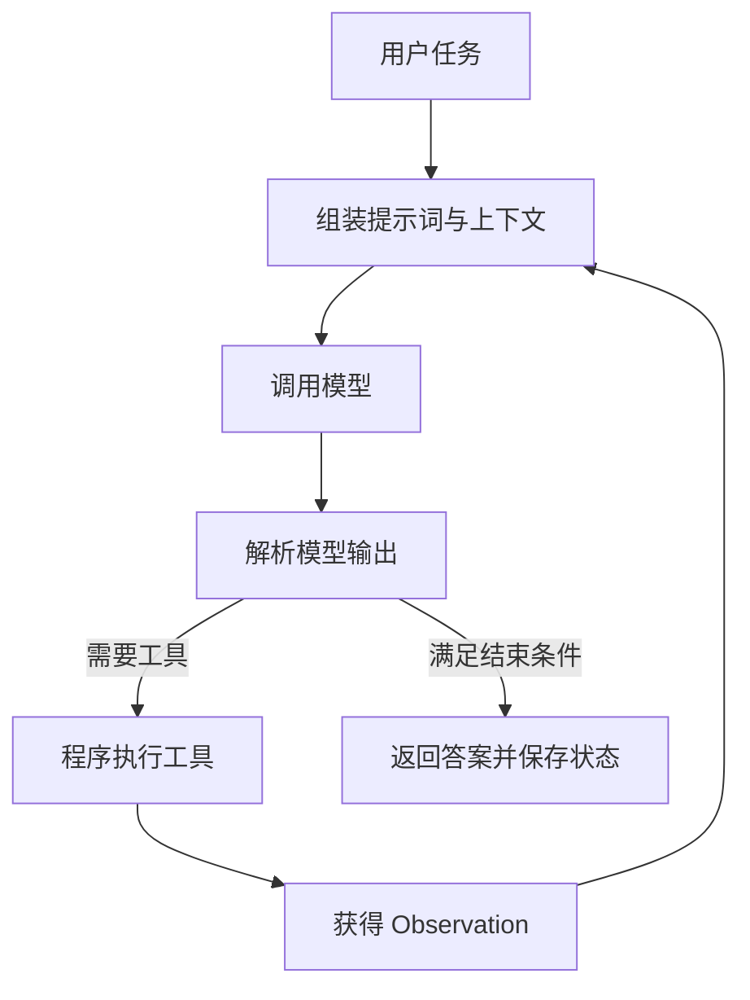
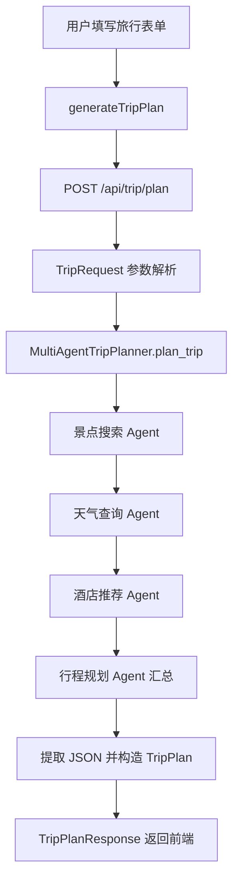

# Hello-Agents 项目系统讲解与源码阅读指南

> 梳理日期：2026-10-25。源码基线：`36f583c`。
> 本文依据当前本地仓库的 README、依赖声明和关键源码整理。已静态核对核心调用链；未安装全部章节依赖，未调用模型、地图、搜索服务，也未执行模型训练。运行命令是按当前源码整理的操作指南，不代表本机已验证通过。

## 详细讲解分册

本文保留整体地图与核心调用链。逐部分、逐章的详细解释放在以下分册，建议按顺序阅读：

| 分册 | 内容 |
| --- | --- |
| [第一部分：智能体与语言模型基础](docs/project-guide/01-智能体与语言模型基础详解.md) | 第一至三章：第一个 Agent、规则系统、Token、Embedding、Transformer |
| [第二部分：构建智能体与框架](docs/project-guide/02-构建智能体与框架详解.md) | 第四至七章：三种范式、低代码、四种框架示例、HelloAgents 扩展 |
| [第三部分：记忆、上下文、协议、训练与评估](docs/project-guide/03-高级能力详解.md) | 第八至十二章：能力的职责、数据流、配置参数与验证方法 |
| [第四部分：三个综合应用](docs/project-guide/04-综合应用详解.md) | 第十三至十五章：旅行、研究、小镇的请求链、模型与状态 |
| [第五部分：毕业设计与社区项目](docs/project-guide/05-毕业设计与社区项目详解.md) | 第十六章：选题、拆分、最小实现、验收、文档与社区案例阅读 |
| [工程补充：环境、调试与源码阅读](docs/project-guide/06-环境调试与阅读实践.md) | 环境隔离、配置生效、问题定位、断点与学习练习 |

各分册区分“当前源码实际行为”和“用于理解或练习的示意设计”；不把演示数据或尚未运行的流程写成已验证能力。

## 1. 先理解：这个项目究竟是什么

Hello-Agents 是 Datawhale 的《从零开始构建智能体》教程仓库。它把理论、可运行示例、综合应用与社区作业放在一起，帮助读者从“调用一次模型”逐步走到“构建有工具、记忆、上下文和协作能力的智能体系统”。

理解整个仓库，可以沿着这条主线：

```text
模型调用 → 控制执行循环 → 调用工具 → 管理记忆与上下文
        → 智能体协作 → 训练与评估 → 完整应用
```

它没有统一的根目录应用入口，也没有覆盖全部代码的根级依赖文件。不同章节和案例有各自的启动方式、依赖与状态存储。阅读时应先选择一条学习路径，再进入对应目录。

### 1.1 三个相似名称，分别代表什么

| 名称 | 含义 | 本仓库中的位置或使用方式 |
| --- | --- | --- |
| Hello-Agents / 当前 `hello-agents` 仓库 | 教程、章节代码与案例集合 | 当前仓库整体 |
| `hello-agents` Python 发行包 | 教程中使用的外部框架依赖 | 通过章节说明或子项目依赖安装 |
| `hello_agents` | Python 导入名 | `from hello_agents import SimpleAgent` |

当前仓库中没有一套根级 `hello_agents/` 框架实现目录。第七章正文展示了框架设计与代码，但配套脚本主要通过继承外部包的类来扩展行为。例如 `MySimpleAgent(SimpleAgent)`、`MyReActAgent(ReActAgent)`。

因此，遇到框架方法内部行为时，需要继续查看**当前解释器实际导入的包源码**。不能把教程正文中的实现片段直接视为本机安装包的实现。

来源：[根 README](README.md)、[第七章正文](docs/chapter7/第七章%20构建你的Agent框架.md)、[MySimpleAgent](code/chapter7/my_simple_agent.py)。

## 2. 目录地图：每部分应该怎样看

```text
hello-agents/
├── README.md / README_EN.md    项目介绍、章节导航与学习说明
├── docs/                      中英文教程、插图与阅读站点
│   ├── index.html             Docsify 站点入口
│   ├── _sidebar.md            中文阅读目录
│   └── chapter1 … chapter16   章节正文
├── code/                      各章节配套代码
│   ├── chapter1 … chapter12   原理、框架、增强能力、训练、评估
│   ├── chapter13              智能旅行助手
│   ├── chapter14              自动化深度研究
│   ├── chapter15              赛博小镇
│   └── chapter16              共创说明
├── Co-creation-projects/       学习者的独立案例与毕业设计
├── Extra-Chapter/              FAQ、环境配置、Skills、GUI/Web Agent 等扩展
├── Additional-Chapter/         补充安装指导等资料
├── .github/                   Issue 模板等协作配置
└── fix_bold_format.py          文档格式处理脚本
```

`docs/` 解释设计，`code/` 展示实现，`Co-creation-projects/` 展示不同作者如何组合能力。社区项目不是官方章节代码的统一运行依赖；其中的技术栈和成熟度需要逐个判断。

文档阅读站点由 [docs/index.html](docs/index.html) 配置，使用 Docsify 渲染 Markdown。它与第十三、十四章 Vue 应用是不同的前端入口。

## 3. 16 章知识体系：每章解决一个什么问题

| 章节 | 核心问题 | 当前仓库中的阅读落点 |
| --- | --- | --- |
| 1 初识智能体 | 模型怎样通过行动与环境交互？ | `code/chapter1/FirstAgentTest.py`，另有 Notebook |
| 2 智能体发展史 | 从规则系统到 LLM Agent 如何演变？ | `code/chapter2/ELIZA.py` |
| 3 大语言模型基础 | Token、嵌入、Transformer 是什么？ | `BPE.py`、`Word_Embedding.py`、`Transformer.py` 等 |
| 4 经典范式 | 怎样编写智能体控制循环？ | `ReAct.py`、`Plan_and_solve.py`、`Reflection.py` |
| 5 低代码平台 | 怎样用可视化工作流组织能力？ | Coze 压缩包、Dify YAML、n8n/FastGPT JSON |
| 6 框架实践 | 怎样借助现成框架实现协作或状态流转？ | AutoGen、AgentScope、CAMEL、Langgraph 子目录 |
| 7 自建框架 | 哪些能力值得抽象为类与接口？ | `my_llm.py`、`my_simple_agent.py`、`my_react_agent.py` |
| 8 记忆与检索 | 怎样使用过往交互和外部知识？ | MemoryTool、RAGTool、工作记忆与完整 RAG 示例 |
| 9 上下文工程 | 本次调用到底应该向模型提供哪些信息？ | ContextBuilder、NoteTool、TerminalTool 与持续工作流 |
| 10 通信协议 | 怎样连接外部工具、其他 Agent 与服务发现？ | MCP、A2A、ANP 配套示例 |
| 11 Agentic-RL | 怎样训练模型改善任务行为？ | 数据、奖励、LoRA、SFT、GRPO、分布式配置 |
| 12 性能评估 | 怎样判断能力是否真正改善？ | BFCL、GAIA、LLM Judge、Win Rate 与人工验证 |
| 13 旅行助手 | 怎样把模型和地图服务组合成 Web 应用？ | `helloagents-trip-planner/` |
| 14 深度研究 | 怎样把研究拆成任务并流式呈现过程？ | `helloagents-deepresearch/` |
| 15 赛博小镇 | 怎样让角色具有人设、记忆和关系变化？ | `Helloagents-AI-Town/` |
| 16 毕业设计 | 怎样独立完成一个智能体应用？ | 章节正文、共创路径与社区项目区 |

章节顺序是完整课程顺序。若希望先掌握代码主干，可以先读 4 → 7 → 8 → 9 → 13，再按兴趣扩展到协议、研究、游戏、训练和评估。

## 4. 先建立共同的架构概念

### 4.1 一次模型调用与一个 Agent 有什么差别

一次模型调用接收消息并返回文本。Agent 还需要由程序决定：是否继续执行、调用哪个工具、怎样回填结果、保存哪些状态、何时结束。



模型提出下一步动作，Python 控制循环负责解析与执行。模型写出 `Search[...]` 本身不会发生搜索，只有程序找到工具函数并调用后才会产生实际结果。

### 4.2 各个组件分别承担什么责任

| 组件 | 责任 | 本项目中的例子 |
| --- | --- | --- |
| LLM 客户端 | 封装模型地址、凭证、请求和响应 | 第四章 `HelloAgentsLLM`、第七章 `MyLLM` |
| Agent | 组织任务执行步骤、循环和结束条件 | ReActAgent、MySimpleAgent |
| Prompt | 约束角色、输入、输出格式和动作选择 | `REACT_PROMPT_TEMPLATE` |
| Tool / Registry | 描述工具能力，按名称找到执行实现 | ToolExecutor、ToolRegistry |
| Memory | 保存与检索历史信息 | MemoryTool、MemoryManager |
| RAG | 检索外部知识，为回答提供依据 | RAGTool |
| ContextBuilder | 在预算内组织本次模型输入 | 第九章 ContextAwareAgent |
| Orchestrator | 决定多个角色或任务的执行顺序 | MultiAgentTripPlanner、DeepResearchAgent |
| API / UI | 接收用户输入、传输结果、呈现状态 | FastAPI、Vue、Godot |

这些是跨案例的职责划分，并不表示所有章节共享同一个基类、数据库或消息类型。

## 5. 最重要的起点：第四章三种经典范式

### 5.1 ReAct：根据工具结果决定下一步

**入口：**[code/chapter4/ReAct.py](code/chapter4/ReAct.py) 的 `__main__`。

**调用链：**

```text
创建 HelloAgentsLLM
→ ToolExecutor.registerTool("Search", 描述, search)
→ ReActAgent.run(question)
→ 拼接工具描述、问题与本轮历史
→ llm_client.think(messages)
→ _parse_output() 提取 Thought / Action
→ Finish[...]：返回答案
→ Search[...]：查找工具函数并调用
→ 把 Action / Observation 写回 history，再次调用模型
```

关键参数与数据形状：

| 项目 | 当前实现 |
| --- | --- |
| `question` | 用户问题字符串 |
| `max_steps` | 默认 5，限制循环步数 |
| `history` | `list[str]`，主要保存 Action 与 Observation |
| `messages` | 每轮构造 `[{"role": "user", "content": prompt}]` |
| 模型输出格式 | `Thought: ...` 与 `Action: Search[...] / Finish[...]` |
| 搜索执行 | `tools.py` 中的 `search()`，调用 SerpApi |

**状态边界：**每次 `run()` 开始都会清空 `history`，这里的历史用于单个问题内的执行反馈。它不会自动成为跨问题聊天记录，也不会持久化到数据库。

**终止边界：**收到 Finish 时返回答案；空响应、解析失败或达到步数上限时结束，可能返回 `None`。工具返回的错误文本也可能作为 Observation 被模型继续读取。

这里通过正则解析普通文本中的动作，没有使用原生结构化 `tool_calls` 字段。因此输出格式是否符合约定，会直接影响运行结果。

配套 [llm_client.py](code/chapter4/llm_client.py) 的 `think()` 虽然设置 `stream=True`，但会先收集所有分片，再返回一个完整字符串。终端可以逐段打印，不代表调用者收到的是生成器。

### 5.2 Plan-and-Solve：先生成计划，再逐步执行

源码：[Plan_and_solve.py](code/chapter4/Plan_and_solve.py)。

```text
PlanAndSolveAgent.run(question)
→ Planner.plan(question)
→ 从 ```python 代码块提取列表
→ ast.literal_eval() 解析计划
→ Executor.execute(question, plan)
→ 逐项传入：原问题 + 完整计划 + 已完成结果 + 当前步骤
→ 最后一步的响应作为执行器结果
```

`Planner` 负责拆分任务；`Executor` 按顺序执行。当前执行器的步骤主要是模型调用，没有第四章 ReAct 的工具调度闭环。

**状态边界：**执行历史保存在本次 `execute()` 的局部字符串中。计划解析失败会得到空列表并终止。另需留意：`Executor.execute()` 返回结果，但 `PlanAndSolveAgent.run()` 当前只打印最终答案，没有显式返回它。

### 5.3 Reflection：生成、评审、修订

源码：[Reflection.py](code/chapter4/Reflection.py)。

```text
生成初始代码 → 保存 execution 记录
→ 评审最新代码 → 保存 reflection 记录
→ 如果反馈包含“无需改进”，结束
→ 否则结合反馈生成修订代码
→ 到达迭代上限后返回最近一次代码
```

`Memory.records` 保存 `{"type": ..., "content": ...}` 轨迹。它是 Python 内存对象，不是第八章的完整长期记忆系统。

当前范例主要让模型评审算法效率，没有自动运行生成代码或执行正确性测试。“模型认为无需改进”与“程序经测试正确”是两个不同的结论。

### 5.4 怎样区分三者

| 范式 | 决策节奏 | 最值得观察的变量 |
| --- | --- | --- |
| ReAct | 每得到一次工具反馈，再决定下一步 | `action`、`observation`、`history` |
| Plan-and-Solve | 先规划，再沿计划执行 | `plan`、`current_step`、`history` |
| Reflection | 对已有结果反复评审与修订 | `last_code`、`feedback`、`records` |

## 6. 第六、七章：从脚本进入框架

第六章提供不同框架的使用方式。比如 [LangGraph 搜索助手](code/chapter6/Langgraph/Dialogue_System.py) 使用 `SearchState` 显式描述消息、搜索词、搜索结果和最终答案，并把理解问题、真实搜索等步骤写成节点。阅读重点是“状态字段如何在节点间传递”，而不只是框架名称。

第七章则围绕模型、Agent、消息、配置和工具建立抽象，配套代码主要通过外部框架进行扩展。

### 6.1 MyLLM：扩展模型提供方

[my_llm.py](code/chapter7/my_llm.py) 的 `MyLLM` 继承 `HelloAgentsLLM`：

- `provider="modelscope"` 时，自行解析 `MODELSCOPE_API_KEY`、模型名与地址，创建 OpenAI 兼容客户端。
- 其他 provider 交回父类初始化。
- [my_main.py](code/chapter7/my_main.py) 加载环境变量、创建 MyLLM，再调用继承的 `think()`。

这里体现的是“保留统一调用接口，替换具体连接配置”。其继承方法的实际行为仍取决于安装的框架版本。

### 6.2 MySimpleAgent：消息历史和工具循环

[my_simple_agent.py](code/chapter7/my_simple_agent.py) 的 `run()` 大致分为两条路径：

```text
组装 system + _history + 当前 user
├── 不启用工具：invoke() → 保存本轮 user / assistant → 返回
└── 启用工具：解析 [TOOL_CALL:工具名:参数]
             → 执行工具 → 回填结果 → 再次 invoke()
             → 保存最终 user / assistant → 返回
```

需要注意四点：

1. 工具开关受 `enable_tool_calling` 和是否有 `tool_registry` 共同控制。
2. 默认 `max_tool_iterations=3`；达到上限后还可能追加一次模型调用用于生成最终响应，所以它不是模型请求总次数上限。
3. 工具结果被拼成普通 `user` 消息；这是本脚本的文本协议实现。
4. 中间工具轨迹主要存在本次调用的 `messages` 中，写入 `_history` 的是原始用户输入和最终回复。

`stream_run()` 有独立实现：它逐段产出 `stream_invoke()` 的内容，完成后保存聊天记录，未包含同样的工具循环。理解同步与流式能力时，应分别看方法体。

### 6.3 MyReActAgent：本轮执行轨迹与对话历史

[my_react_agent.py](code/chapter7/my_react_agent.py) 中有两个容易混淆的状态：

- `current_history`：每次 `run()` 清空，用来构造本轮 ReAct 提示词。
- 基类消息历史：结束时通过 `add_message()` 保存用户输入和回答。

当前 `run()` 组装提示词时使用的是 `current_history`，没有把基类全部聊天历史拼进去。因此“对象中保存了聊天历史”并不意味着“每轮推理自动使用这些历史”。

## 7. 第八、九章：记忆、RAG、上下文怎样协作

### 7.1 三种能力的区别

| 能力 | 主要回答的问题 | 常见输入 | 产出 |
| --- | --- | --- | --- |
| Memory | 之前发生过什么，哪些历史相关？ | 对话、事件、重要性、用户信息 | 相关历史记录 |
| RAG | 外部资料中有哪些依据？ | 文档、问题、检索配置 | 相关知识片段 |
| 上下文工程 | 这一次调用应提供哪些内容？ | 指令、历史、记忆、检索结果、预算 | 本次模型输入 |

它们的组合关系可以理解为：

```text
用户问题
  ├── 检索相关历史 → Memory
  ├── 检索外部知识 → RAG
  └── 当前任务与对话历史
            ↓
      ContextBuilder 组织与裁剪
            ↓
          模型回答
            ↓
      选择需要保存的新信息
```

### 7.2 第八章的源码阅读重点

[02_MemoryTool_Architecture.py](code/chapter8/02_MemoryTool_Architecture.py) 演示 `MemoryTool → MemoryManager → 不同记忆类型` 的分层，涉及 working、episodic、semantic、perceptual 四类记忆。

[10_RAG_Pipeline_Complete.py](code/chapter8/10_RAG_Pipeline_Complete.py) 通过 `RAGTool` 演示文档摄取与查询，初始化参数包括：

- `knowledge_base_path`：知识库相关文件路径。
- `rag_namespace`：检索空间标识。

阅读顺序可以是基础操作 → 工作记忆 → 文档转换 → 检索 → Agent 工具集成 → 完整问答。

注意区分“示例打印的架构说明”与“外部依赖当前实际使用的后端”。SQLite、Qdrant、Neo4j 等能力应结合启用的记忆类型、依赖版本和运行配置核实，不需要为了学习最小示例就安装所有存储组件。

### 7.3 第九章的实际集成与边界

[02_context_builder_with_agent.py](code/chapter9/02_context_builder_with_agent.py) 中：

```text
ContextAwareAgent.run(user_input)
→ context_builder.build(
    user_query,
    conversation_history,
    system_instructions
  )
→ 把 optimized_context 放入 system 消息
→ 调用模型
→ 将本轮用户与助手消息加入 conversation_history
```

`ContextConfig(max_tokens=4000)` 控制上下文预算。当前示例中 MemoryTool、RAGTool 及重要交互写入记忆的代码被注释，运行该文件不会自动启用完整的“记忆 + RAG”组合。

还有一个版本核对点：这里使用 `self.llm.invoke(messages).content`，但第七章部分实现把 `invoke()` 结果直接当字符串处理。出现属性错误时，应先确认有效包版本和返回类型。

## 8. 第十至十二章：接入、训练与评估

### 8.1 协议章节分别研究什么

| 方向 | 本教程中的学习重点 | 源码入口 |
| --- | --- | --- |
| MCP | 把外部能力接到 Agent 工具层 | `my_mcp_server.py`、`02_Connect2MCP.py`、`05_UseMCPToolInAgent.py` |
| A2A | 为 Agent 暴露技能，通过客户端或其他 Agent 调用 | `09_A2A_Server.py`、`09_A2A_Client.py` |
| ANP | 服务注册、发现、能力信息与节点选择 | `11_ANPInit.py`、`12_ANPTaskDistribution.py` |

[my_mcp_server.py](code/chapter10/my_mcp_server.py) 通过 `FastMCP` 和 `@mcp.tool()` 暴露数学与文本函数。阅读时追踪“客户端发现能力 → 传参调用 → 服务端执行 → 结果回到 Agent”。

[A2A 服务端示例](code/chapter10/09_A2A_Server.py) 的研究结果是简化构造的数据；[ANP 任务分配示例](code/chapter10/12_ANPTaskDistribution.py) 的计算节点地址和负载信息用于演示注册与选择。不能把示例节点选择理解为真实集群已经完成训练或数据处理。

### 8.2 Agentic-RL：改善模型本身的行为

[06_complete_pipeline.py](code/chapter11/06_complete_pipeline.py) 将训练流程组织成：

```text
读取 config.json
→ 准备数据
→ SFT 训练
→ SFT 评估
→ GRPO 训练
→ 后续评估与结果处理
```

脚本通过外部 `RLTrainingTool.run({...})` 传递动作、算法和训练参数，再解析 JSON 结果。`accelerate_configs/` 另提供 DDP、DeepSpeed ZeRO 等配置示例。

SFT 使用示范数据训练；GRPO 围绕采样结果和奖励进行优化；LoRA 用于参数高效微调。调整这些训练行为，与应用层改变提示词、增加工具或裁剪上下文属于不同工作层次。

本章依赖训练栈、模型与数据，资源需求也与普通 API 示例不同。阅读训练参数和奖励函数后，再选择适合本机或服务器的训练方案。

### 8.3 评估：运行完成之后还要看什么

根据 [第十二章 README](code/chapter12/README.md)：

- BFCL 示例关注工具调用能力。
- GAIA 示例关注综合助理任务。
- 数据生成流程结合 LLM Judge、Win Rate 和人工验证。
- `template_output/` 与 `data_generation/` 中有报告和结果样例，可学习输出结构。

已有报告中的分数属于对应实验，README 的“预期输出”属于示例说明，都不能作为当前解释器、模型与配置的实测成绩。

## 9. 综合案例一：智能旅行助手

项目目录：[code/chapter13/helloagents-trip-planner](code/chapter13/helloagents-trip-planner/README.md)。

### 9.1 入口与模块分工

| 层 | 源码 | 作用 |
| --- | --- | --- |
| 页面 | `frontend/src/views/Home.vue`、`Result.vue` | 输入需求与展示行程 |
| 前端 API | `frontend/src/services/api.ts` | Axios 请求，默认后端 `http://localhost:8000` |
| 后端启动 | `backend/run.py` | 使用 Uvicorn 启动 `app.api.main:app` |
| 应用 | `backend/app/api/main.py` | CORS、配置校验、注册路由 |
| 旅行接口 | `backend/app/api/routes/trip.py` | 接收规划请求并包装响应 |
| 编排 | `backend/app/agents/trip_planner_agent.py` | 组织多个专家 Agent |
| 数据契约 | `backend/app/models/schemas.py` | TripRequest、TripPlan、TripPlanResponse |
| 外部服务 | `backend/app/services/` | 模型、地图、图片等能力 |

### 9.2 一次请求的完整调用链



请求包含城市、开始/结束日期、旅行天数、交通方式、住宿偏好、偏好标签和补充要求。`travel_days` 约束为 1～30。日期在请求模型中是字符串，不能仅凭字段名称推断完整日期合法性与跨字段一致性都已校验。

`MultiAgentTripPlanner` 创建四个 SimpleAgent，前三个共享高德 MCP 工具，最后一个汇总结果。高德工具通过 `server_command=["uvx", "amap-mcp-server"]` 启动。

**执行顺序是串行的：**景点 → 天气 → 酒店 → 规划。多个专家角色并不意味着自动并行或分布式运行。

### 9.3 状态、失败与成功的边界

- `get_trip_planner_agent()` 缓存规划器对象，多个请求可能复用内部 Agent 实例。是否保存和隔离历史，还需结合安装的框架实现核对。
- 编排方法和 JSON 解析方法都有备用计划逻辑。模型或工具失败后，可能仍返回一个结构完整的 TripPlan。
- 路由在取得 TripPlan 后包装 `success=True`。因此业务成功字段不等于外部查询全部成功，阅读结果时应关注是否走了 fallback。
- `async def` 路由内部直接调用同步 `agent.plan_trip()`。当前源码没有把这些同步调用自动转换成后台并行任务。
- 前端 Axios 超时为 120 秒。页面超时后，后端工作是否继续，要看服务端执行情况，不能仅根据前端错误判断。
- 当前旅行健康检查路由引用 `agent.agent`，而规划器初始化创建的是四个命名 Agent。阅读或联调该健康接口时需要核对这一属性是否匹配。

关键源码：[旅行路由](code/chapter13/helloagents-trip-planner/backend/app/api/routes/trip.py)、[规划器](code/chapter13/helloagents-trip-planner/backend/app/agents/trip_planner_agent.py)、[前端 API](code/chapter13/helloagents-trip-planner/frontend/src/services/api.ts)。

## 10. 综合案例二：自动化深度研究

主编排：[backend/src/agent.py](code/chapter14/helloagents-deepresearch/backend/src/agent.py)。HTTP 入口：[backend/src/main.py](code/chapter14/helloagents-deepresearch/backend/src/main.py)。

### 10.1 分工与数据模型

```text
DeepResearchAgent
├── PlanningService       将研究主题拆成 TodoItem
├── 搜索服务               dispatch_search / prepare_research_context
├── SummarizationService  对单个任务的资料进行总结
├── ReportingService      综合生成 Markdown 报告
├── NoteTool              按配置保存任务笔记与报告
└── ToolCallTracker       跟踪工具执行事件
```

`TodoItem` 包括任务 ID、标题、意图、搜索 query、状态、摘要、来源和笔记信息。`SummaryState` 保存整个研究的任务列表、资料、来源与最终报告。

这些显式状态使前端能够区分“正在搜索”“某任务完成”“报告完成”，而不仅展示一段最终文本。

### 10.2 两个 HTTP 入口

| 路由 | 方法 | 代码路径与输出 |
| --- | --- | --- |
| `/research` | POST | `agent.run()`，一次返回报告和任务列表 |
| `/research/stream` | POST | `agent.run_stream()`，返回 SSE 事件流 |
| `/healthz` | GET | 返回进程健康状态 |

前端 [api.ts](code/chapter14/helloagents-deepresearch/frontend/src/services/api.ts) 使用 `fetch()` 发起 POST，读取响应流，按空行分隔事件，再解析 `data:` 后面的 JSON。

流式主路径：

```text
topic → 规划 Todo 列表 → 为各任务创建工作线程
→ 搜索与整理来源 → 流式生成任务摘要
→ 将事件写入 Queue → 主生成器向客户端输出事件
→ 等待工作线程完成 → 生成总报告 → 保存笔记 → done
```

事件包括 `status`、`todo_list`、`task_status`、`sources`、`task_summary_chunk`、`final_report`、`done`。任务通过 `task_id` 和 `stream_token` 关联，不能依赖事件到达顺序推断它属于哪个任务。

### 10.3 需要特别理解的状态边界

- 每次 HTTP 研究请求新建 DeepResearchAgent 和研究状态；笔记目录则由配置决定，可能跨请求保留。
- 流式执行通过 `Thread + Queue` 协调，部分共享研究状态通过 Lock 更新。这不是单纯的模型 token 转发。
- 前端可以通过 AbortSignal 中止读取；源码没有对应的完整后端任务取消状态机，断开连接不代表所有线程立即停止。
- 普通 `run()` 看起来按顺序执行任务，但有一个静态可见的问题：它直接调用含 `yield` 的 `_execute_task()`，没有迭代返回的生成器。按 Python 生成器语义，搜索与总结方法体不会因此被执行。流式入口使用 `for event in self._execute_task(...)`，会真正消费它。联调时应将两个入口分别验证；本文只记录这一问题，没有修改实现。
- `SummaryState` 的列表字段带有 `Annotated[..., operator.add]`，但此处状态仍是普通 dataclass；实际累计通过方法里的 `append()` 完成，不能据此推断有 LangGraph 在自动归并状态。

配置来源为 [config.py](code/chapter14/helloagents-deepresearch/backend/src/config.py)：代码默认 provider 为 Ollama，而 `.env.example` 展示的是 custom；最终值取决于进程中真正加载的环境变量和请求覆盖参数。

## 11. 综合案例三：赛博小镇

项目说明：[Helloagents-AI-Town/README.md](code/chapter15/Helloagents-AI-Town/README.md)。

### 11.1 架构与两条独立流程

客户端使用 Godot，后端使用 FastAPI；角色管理、记忆和关系更新位于 Python 后端。

**玩家对话路径：**

```text
Godot api_client.gd.send_chat()
→ POST /chat
→ NPCAgentManager.chat(npc_name, message, player_id)
→ 获取好感度与对话风格
→ 检索 working / episodic 记忆
→ 将关系、记忆和当前消息组成增强输入
→ SimpleAgent.run()
→ 分析并更新好感度
→ 保存对话到记忆
→ 返回 NPC 回复
```

**环境状态路径：**

```text
FastAPI lifespan
→ NPCStateManager.start()
→ 首次批量生成对白
→ 后台定时循环，默认间隔 30 秒
→ NPCBatchGenerator.generate_batch_dialogues()
→ 更新 current_dialogues 缓存
→ Godot 通过 GET /npcs/status 读取
```

后一条路径批量生成环境对白，减少逐角色请求次数；玩家主动聊天则进入带记忆和好感度的交互流程。

### 11.2 角色与持久化

[agents.py](code/chapter15/Helloagents-AI-Town/backend/agents.py) 定义张三、李四、王五的职业、性格、位置、风格与爱好，并为每个 NPC 创建 Agent 和 MemoryManager。

| 状态 | 保存位置或管理者 | 阅读时要确认的边界 |
| --- | --- | --- |
| 人设 | `NPC_ROLES` 和 system prompt | 属于程序配置 |
| Agent 对话状态 | 各 NPC 的 Agent 对象 | 同一进程内复用 |
| 工作与情景记忆 | 每个 NPC 的 MemoryManager | 配置路径为 `backend/memory_data/<NPC名>` |
| 好感度 | RelationshipManager | 当前管理器中使用字典保存，不能默认重启后保留 |
| 环境对白 | NPCStateManager.current_dialogues | 进程内缓存，周期更新 |

记忆管理器按 NPC 建立，玩家信息也会传入部分操作。阅读多玩家隔离时，要继续核对检索是否带玩家过滤，不能仅凭 `player_id` 参数认定所有状态已经隔离。

LLM 初始化失败时，NPC 管理器可回退到模拟回复。因此看到角色回复，需要进一步确认是真实模型生成还是模拟模式。

源码入口：[main.py](code/chapter15/Helloagents-AI-Town/backend/main.py)、[agents.py](code/chapter15/Helloagents-AI-Town/backend/agents.py)、[state_manager.py](code/chapter15/Helloagents-AI-Town/backend/state_manager.py)、[Godot API 客户端](code/chapter15/Helloagents-AI-Town/helloagents-ai-town/scripts/api_client.gd)。

## 12. 环境与运行：按章节准备

### 12.1 先确认实际解释器与依赖版本

在准备运行的 Python 环境中执行：

```bash
python -c 'import sys; print(sys.executable)'
python -m pip show hello-agents
python -c 'import hello_agents; print(hello_agents.__file__)'
```

PyCharm 中应确认项目选用的解释器与安装依赖的解释器一致。根目录没有统一依赖文件；不要把不同章节的全部依赖一次混装。

当前仓库存在明确的版本跨度：

| 位置 | 声明或教学使用的版本 |
| --- | --- |
| 第七章正文 | `hello-agents==0.1.1` |
| 第十二章 README | `hello-agents[evaluation]==0.2.3` |
| 旅行助手 requirements | `hello-agents[protocols]>=0.2.4,<=0.2.9` |
| 深度研究 pyproject | `hello-agents==0.2.9` |
| 赛博小镇 requirements | `hello-agents>=0.2.4,<=0.2.9` |

这是历史示例的依赖信息。运行某个案例时优先使用它自己的声明，遇到签名或返回类型不匹配，再对照源码处理。根 README 提到框架新版本，也不意味着所有历史示例已经迁移。

### 12.2 最小学习起点：第四章

可先在独立环境中准备代码直接使用的依赖：

```bash
cd /Users/jiangfengtime/WorkSpace/hello-agents/code/chapter4
python -m pip install openai python-dotenv
```

在该目录创建自己的 `.env`，填写模型服务提供的配置：

```dotenv
LLM_MODEL_ID=你的模型名称
LLM_API_KEY=你的密钥
LLM_BASE_URL=你的OpenAI兼容接口地址
LLM_TIMEOUT=60
```

先运行纯模型调用：

```bash
python llm_client.py
python Plan_and_solve.py
python Reflection.py
```

ReAct 还会导入 SerpApi 客户端，并在执行搜索时读取 `SERPAPI_API_KEY`。需要另外核对已安装包是否导出源码使用的 `SerpApiClient`，再运行 `python ReAct.py`。

先验证模型客户端，再验证搜索，最后验证 ReAct 循环，能更容易判断错误发生在哪一层。

### 12.3 旅行助手

后端在其独立环境中执行：

```bash
cd /Users/jiangfengtime/WorkSpace/hello-agents/code/chapter13/helloagents-trip-planner/backend
python -m pip install -r requirements.txt
cp .env.example .env
# 编辑 .env：填写 LLM 和高德等实际配置
python run.py
```

前端在另一终端执行：

```bash
cd /Users/jiangfengtime/WorkSpace/hello-agents/code/chapter13/helloagents-trip-planner/frontend
npm ci
cp .env.example .env
# 编辑 .env：填写前端地图配置，核对 API 地址
npm run dev
```

后端启动会校验 `AMAP_API_KEY`。MCP 子进程使用 `uvx`，首次启动还可能需要下载服务包。前端与后端的地图配置用途不同，具体字段以各自 `.env.example` 为准。

### 12.4 深度研究

该后端提供 `pyproject.toml` 与 `uv.lock`。可在安装 uv 后按锁文件同步环境，再从 `src` 启动，以匹配当前平级导入写法：

```bash
cd /Users/jiangfengtime/WorkSpace/hello-agents/code/chapter14/helloagents-deepresearch/backend
cp .env.example .env
# 编辑 .env：选择模型与搜索服务
uv sync --frozen --no-install-project
cd src
../.venv/bin/python -m uvicorn main:app --env-file ../.env --host 127.0.0.1 --port 8000
```

这里使用 `--no-install-project`，仅安装声明的依赖；启动位置与 `main.py` 中 `from config import ...` 等导入方式对应。通过 `--env-file` 显式加载环境，避免以为 Configuration 自己会读取 `.env` 文件。

前端位于该案例的 `frontend/`，执行 `npm ci` 和 `npm run dev`；API 地址读取 `VITE_API_BASE_URL`，默认后端 8000 端口。优先验证流式入口，并注意前文记录的普通入口生成器问题。

### 12.5 赛博小镇

```bash
cd /Users/jiangfengtime/WorkSpace/hello-agents/code/chapter15/Helloagents-AI-Town/backend
python -m pip install -r requirements.txt
cp .env.example .env
# 编辑模型配置
python main.py
```

客户端在 Godot 中导入 `helloagents-ai-town/project.godot`，核对 `scripts/config.gd` 的后端地址，再运行场景。

三个综合案例默认都使用后端 8000 端口。分别启动最省事；若同时运行，需要协调服务端口与对应客户端地址。

### 12.6 本地阅读教程

在仓库根目录执行：

```bash
python -m http.server 8080 --directory docs
```

浏览器打开 `http://localhost:8080`。页面依赖 Docsify 等 CDN 资源，网络无法访问时，直接使用编辑器阅读 Markdown 即可。

## 13. 调试时按层定位

| 表现 | 优先检查位置 | 判断依据 |
| --- | --- | --- |
| `ModuleNotFoundError` | 解释器、环境、依赖声明 | 包是否装在当前运行的解释器中 |
| 导入类或方法失败 | `hello-agents` 版本 | 教程与实际包的导出接口是否一致 |
| API 连接失败 | 模型地址、网络、服务状态 | 先独立运行 LLM 客户端 |
| 鉴权失败 | 生效的 provider 与凭证 | 不同章节可能读取不同变量名 |
| 返回 422 / 参数错误 | 请求体与消息结构 | 对照 Pydantic 或模型服务 schema |
| `Action` 解析失败 | 模型原始文本 | 是否满足正则要求的格式 |
| 工具找不到或启动失败 | Registry、子进程命令、凭证 | 工具是否注册，uvx 等命令是否可用 |
| 页面超时 | 前端超时与后端日志 | 前端停止等待不等于后端完成或取消 |
| 返回结构正常但内容不可信 | fallback、模拟模式、来源 | 是否真的取得外部数据并用于生成 |
| 记忆没被使用 | 保存、检索、上下文拼接三处 | 写入成功不等于检索成功或进入提示词 |

建议在以下位置打断点：模型调用前后的 `messages / response`；ReAct 的 `action / observation`；旅行规划器每次 `.run()` 之后与 `_parse_response()`；深度研究任务状态变化处；小镇记忆检索和好感度更新处。

第七章的部分 `test_*.py` 会请求真实模型和搜索服务，并主要打印结果、捕获异常。文件名带 test 并不代表它们都是隔离、无网络、带严格断言的单元测试，运行前应先阅读入口。

## 14. 推荐的源码学习路线

| 阶段 | 阅读与实践 | 学完应能回答 |
| --- | --- | --- |
| 1 模型连接 | 第四章 `llm_client.py` | 模型配置从哪里来？响应是什么类型？ |
| 2 执行循环 | 第四章 `tools.py → ReAct.py` | 谁决定下一步？谁真正执行工具？ |
| 3 控制策略 | Plan-and-Solve、Reflection | 计划与反思分别改变了哪段流程？ |
| 4 框架抽象 | 第七章 LLM、SimpleAgent、ReAct 扩展 | 哪些状态属于一次任务，哪些属于对象？ |
| 5 信息增强 | 第八章基础操作，再到第九章 ContextBuilder | 信息如何保存、检索并进入本次输入？ |
| 6 完整应用 | 第十三章前端 → API → 编排 → 模型与工具 | 一次 HTTP 请求如何变成结构化行程？ |
| 7 深化方向 | 第十章接入、第十四章研究、第十五章游戏 | 怎样实现外部能力连接、并发或长期交互？ |
| 8 能力验证 | 第十二章评估，再按需学习第十一章训练 | 用什么证据证明系统改善？ |

阅读每个新模块时，都按同一组问题做笔记：

1. **入口**：哪个脚本、路由或页面触发？
2. **调用链**：按什么顺序进入哪些函数？
3. **参数**：数据类型、默认值、配置来源是什么？
4. **执行步骤**：哪里调用模型，哪里执行真实工具？
5. **状态边界**：哪些是局部变量、对象状态、共享缓存和持久化数据？
6. **结束与失败**：如何停止，出错是抛异常、返回空值还是回退方案？

## 15. 关键源码索引

- [项目介绍与课程导航](README.md)
- [第四章模型客户端](code/chapter4/llm_client.py)
- [第四章工具注册与搜索](code/chapter4/tools.py)
- [第四章 ReAct 控制循环](code/chapter4/ReAct.py)
- [第四章 Plan-and-Solve](code/chapter4/Plan_and_solve.py)
- [第四章 Reflection](code/chapter4/Reflection.py)
- [第六章 LangGraph 状态流转](code/chapter6/Langgraph/Dialogue_System.py)
- [第七章框架设计正文](docs/chapter7/第七章%20构建你的Agent框架.md)
- [第七章模型提供方扩展](code/chapter7/my_llm.py)
- [第七章 SimpleAgent 扩展](code/chapter7/my_simple_agent.py)
- [第七章 ReActAgent 扩展](code/chapter7/my_react_agent.py)
- [第八章 MemoryTool 分层示例](code/chapter8/02_MemoryTool_Architecture.py)
- [第八章完整 RAG 示例](code/chapter8/10_RAG_Pipeline_Complete.py)
- [第九章 ContextBuilder 集成](code/chapter9/02_context_builder_with_agent.py)
- [第十章自定义 MCP 服务](code/chapter10/my_mcp_server.py)
- [第十一章训练流程](code/chapter11/06_complete_pipeline.py)
- [第十二章评估使用说明](code/chapter12/README.md)
- [旅行助手编排](code/chapter13/helloagents-trip-planner/backend/app/agents/trip_planner_agent.py)
- [深度研究编排](code/chapter14/helloagents-deepresearch/backend/src/agent.py)
- [小镇 NPC 管理](code/chapter15/Helloagents-AI-Town/backend/agents.py)
- [社区共创说明](Co-creation-projects/README.md)

本文覆盖仓库整体结构与主干实现，没有逐一审查所有社区项目。文中标出的版本差异和实现问题来自静态阅读，后续修复或运行验证可分别进行。
